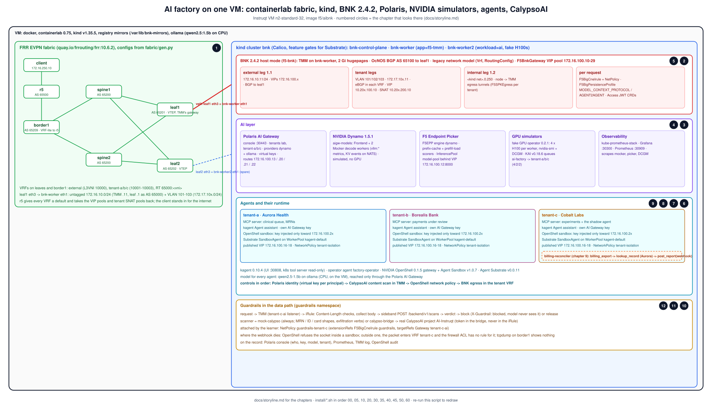

# BNK AI factory on containerlab

The EVE-NG lab (`iracic82/Home_k8s`) rebuilt so it fits one Instruqt VM: BIG-IP Next for Kubernetes 2.4.2 in host
mode on a kind cluster, with an FRR spine/leaf/border fabric around it, wired together by containerlab. Same
address plan, same tenants, same agents, OpenShell and Agent Substrate included. No NICo and no semantic router.

This is a new lab in its own repository and its own Instruqt track. The earlier tracks in `bnk-ai-factory-lab`
stay as they are.

## What kind does and does not save

kind removes VMs. It does not shrink BNK. Measured on a licensed install (`bnk-ai-factory-real/SIZING.md`):
BNK requests 22.55 vCPU in total, and TMM alone is 4.6 vCPU plus 2 Gi of 2 Mi hugepages. On kind every node is
a container on the same kernel, so the whole request lands on one VM. The Instruqt machine type is therefore
n2-standard-32 (32 vCPU, 128 GB), one of them, with a custom image because stock images have a 10 GB disk.

What it does save: two VMs, the ssh-and-join step, the sequential-setup trap, and start time once the images
are baked in.

## Shape

```
                 [client]──[r5 (FRR, AS 65500)]           stands in for the Cisco R5
                               │ eth1
                           [border1]  AS 65209           VRF external + tenant VRFs, VRF-lite handoff to r5
                           ╱        ╲
                    [spine1]      [spine2]   AS 65200     eBGP unnumbered underlay, EVPN overlay
                    ╱     ╲      ╱     ╲
               [leaf1] AS 65201      [leaf2] AS 65202     VTEPs; eth3 is the handoff to a worker
                  │ eth3                 │ eth3
  ┌───────────────┴──────┐   ┌───────────┴───────────┐
  │ bnk-worker           │   │ bnk-worker2           │   kind cluster "bnk" (k8s-kind + ext-container links)
  │ eth1 = BNK external  │   │ eth1 = BNK external   │   TMM self IP 172.16.10.11 / .12, VLAN 101-103 per tenant
  │ TMM (app=f5-tmm)     │   │ sims, agents, GPUs    │
  └──────────────────────┘   └───────────────────────┘
                 [bnk-control-plane]                      kube API, BNK control plane, Polaris console
```

One TMM, on `bnk-worker`. Labelling a second node sends the lifecycle operator into a panic loop
(`bnk-deploy/lib/05-nodes.sh` has the measurement); I re-check that on 2.4.1 before deciding otherwise.



## What is in here

| Path | What |
|---|---|
| `clab/bnk-factory.clab.yml` | the containerlab topology: FRR fabric, r5, client, the kind cluster and its node links |
| `clab/kind-config.yaml` | kind 1.35: one control plane, two workers, no default CNI (Calico 3.32), the feature gates Agent Substrate needs, pod CIDR 192.168.0.0/16 |
| `fabric/gen.py` | writes `fabric/nodes/<node>/{frr.conf,daemons,setup.sh}` from `fabric/nodes.csv` (ASNs, loopbacks, VRFs, VNIs) |
| `install/00-host-prep.sh` | hugepages, inotify limits, docker and tool checks. The only step that needs root on the host |
| `install/05-registry-mirrors.sh` | one pull-through registry per upstream (repo.f5.com with the FAR credential, docker.io, quay.io, ghcr.io, registry.k8s.io, nvcr.io, gcr.io); the baked Instruqt image carries their cache, so track start pulls nothing |
| `install/10-fabric.sh` | `gen.py`, `containerlab deploy` in the background, Calico as soon as the API answers (containerlab waits for Ready), mirrors wired into every node's containerd |
| `install/20-cluster.sh` | kubelet restart so nodes advertise hugepages, taints, node labels |
| `install/30-bnk.sh` | clones `iracic82/bnk-deploy` and runs it unmodified (`--env lab --profile host`, BNK 2.4.0), raises it to 2.4.2 with the installer's own `upgrade.sh`, then patches on the AI features and the legacy network model (OcNOS, VRFs) |
| `install/35-bnk-network.sh` | TMM on the fabric: external, internal and per-tenant VLAN legs, the VIP pool, OcNOS routing templates, BGP to leaf1 in the default domain and in every tenant VRF, the tenant VRFs with a first VIP each, per-tenant egress; proves it from the client behind r5 |
| `install/40-ai.sh` | GAIE CRDs, NVIDIA Dynamo (platform, NATS, two Mocker workers with real `vllm:*` metrics and KV events), the model pool behind its VIP with F5's Endpoint Picker, ollama on the VM for the agents' CPU model, the Polaris AI Gateway with one tenant per lab tenant (providers, models, virtual keys, a route on its own VIP), fake GPU operator (4 x H100 per worker) and KAI queues |
| `install/45-observability.sh` | Prometheus and Grafana (kube-prometheus-stack), scraping the mocker, the picker and the fake DCGM exporter |
| `install/50-agents.sh` | kagent 0.10.4 (model through the AI Gateway), the operator's agent, one agent app + MCP server + kagent Agent per tenant, NVIDIA OpenShell (gateway + Agent Sandbox controller, one provider and sandbox per tenant; the key is injected only toward that tenant's AI Gateway), Agent Substrate v0.0.11. The shadow agent is written (`manifests/agents/shadow-agent.yaml`) and applied by the learner in chapter 9, never by the installer |
| `install/60-guardrails.sh` | CalypsoAI: the mock scanner always, the real service through an in-cluster TLS bridge when a key is present; the guardrail `F5BigCneIrule` is created, and the `NetPolicy` that attaches it to Cobalt's gateway is written for the learner to apply in chapter 10 |
| `install/lib/` | `common.sh` (pins, paths, helpers), `expose.sh` (UIs published on the host by socat units that follow a Service's ClusterIP) |
| `manifests/` | what the install steps apply: `bnk/` (legs, routing, tenants, egress), `tenants/` (namespaces, hello apps), `ai/`, `agents/` (kagent values, agents, the tenant agent app, OpenShell profile), `guardrails/` (mock, iRule, bridge) |
| `docs/storyline.md` | the lab's story and the chapter plan |
| `instruqt/bnk-ai-factory-clab/` | the track: `config.yml` (one n2-standard-32 VM, image `f5/aibnk`, team secrets), `track.yml`, `track_scripts/setup-factory` (runs `install/*` in order), `build/bake-image.sh` + `finalise-image.sh` (the custom image), `SIZING.md` |

Secrets never live here. Locally they come from `~/bnk-secrets`; on Instruqt from team secrets on the `f5` team
(`FAR_PULL_B64`, `BNK_LICENSE_JWT`, `GH_READ_TOKEN`; `AI_CALYPSO_API` and `AI_CALYPSO_PROJECT` for the real
CalypsoAI project "AI-Instruqt"). The baked image carries no secret: the bake's `finalise-image.sh` removes them and
checks for key material before it says "ready to save".

## Where the pieces come from

Copied in, never referenced, so this repo stands alone:

- Fabric design and address plan: `Home_k8s/install/fabric` (ASNs, loopbacks, VRFs, L3VNIs, the exit to R5).
- BNK install: `iracic82/bnk-deploy`, public, cloned at install time. Its own CI already installs BNK phases
  00 to 40 on kind 1.30 with Calico (this lab runs 1.35, the installer warns and continues) (`.github/workflows/e2e-kind.yml`), which is the recipe `20-cluster.sh` follows.
- kagent values and the tenant agent: `Home_k8s/install/ai4`, `Home_k8s/apps/tenant-agent`.
- Guardrail iRule and the mock Calypso service: `bnk-ai-kv-lab/instruqt/bnk-ai-demos-kv/manifests/41,44`.
- Real CalypsoAI wire format: `bnk-ai-lb-poc-ref/f5-runtime-security/guardrails_connector`
  (`POST /backend/v1/scans`, `Authorization: Bearer`, verdicts `cleared` / `flagged` / `redacted`).

## Status

- 2026-10-31: repository started. Fabric + kind + Calico proven on a workstation (EVPN end to end, client behind r5
  reaches every leaf handoff). Everything from BNK upward is written to run first on the Instruqt custom-image VM
  (`f5/aibnk`): the bake is the first full run and its log is the test report. Chapters are not written yet; the
  storyline is.
