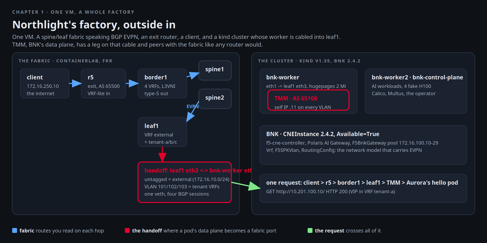

# One VM, a whole factory

Northlight Compute sells slices of one AI factory to enterprises that will never build their own. Three of them
signed this quarter: Aurora Health, Borealis Bank and Cobalt Labs. They will share the fabric, the cluster and the
GPUs, and each was promised that nothing of theirs touches the others. Mira Voss runs the platform team, and the
first thing she does with a new factory is walk it, outside in, reading each hop's own tables.



The whole factory is on this VM. containerlab runs the fabric (two spines, two leaves, a border router), the exit
router r5 and a client, and wires a three node kind cluster into the leaves with real veths. F5 BIG-IP Next for
Kubernetes, BNK, runs on the cluster. Its data plane, TMM, has a leg on that cable and peers with leaf1 like any
other router. Whatever you read in a later chapter, a tenant's VIP, an agent's model call, a packet that never
leaves, goes through what you see here.

[button label="Open the Lab Topology" variant="outline"](tab-2)

The **Lab Topology** tab is the interactive version of that picture. Pick a flow and step through it hop by hop.
It opens on **A client reaches a tenant VIP**, which is the request you send at the end of this chapter. Keep it
open. It polls the VM and colours what is up.

## The room

Mira starts with the inventory. Every box on the map is a container on this machine, and containerlab knows which
is which:

```bash,run
containerlab inspect -t $LAB_ROOT/clab/bnk-factory.clab.yml 2>/dev/null | grep -E 'Name|spine|leaf|border|r5|client|bnk-' | head -14
docker ps --format '{{.Names}}\t{{.Image}}' | sort | column -t
```

Six FRR routers and a client from the topology file, three kind nodes the cluster made, seven registry mirrors
that fed the build, and ollama. Open the **Lab Topology** tab now and keep it open: it reads these same sources
every few seconds and colours what is up.

## The underlay

Mira's rule: never trust a diagram until a router agrees with it. Start at spine1. It should see three neighbours
on unnumbered interfaces, each in its own AS:

```bash,run
docker exec spine1 vtysh -c 'show bgp summary' | sed -n '/IPv4 Unicast/,/Total/p'
```

`leaf1(eth1)`, `leaf2(eth2)`, `border1(eth3)`: BGP sessions named by interface, no IPv4 addresses on the links.
The same from leaf1's side, with both spines:

```bash,run
docker exec leaf1 vtysh -c 'show bgp summary' | sed -n '/IPv4 Unicast/,/Total/p'
docker exec leaf1 vtysh -c 'show ip route bgp' | head -12
```

What the underlay carries is small on purpose: every node's loopback. leaf1 can reach border1's loopback by two
equal paths, one per spine:

```bash,run
docker exec leaf1 vtysh -c 'show ip route 10.255.0.21'
docker exec leaf1 ping -c 2 -W 1 -I 10.255.0.11 10.255.0.21 | tail -2
```

## The overlay

On the same sessions the fabric carries EVPN. Each VRF is an L3VNI, and a VRF route leaves a leaf as a type-5. Here
are leaf1's VNIs, one per VRF, and the type-5 routes it has imported:

```bash,run
docker exec leaf1 vtysh -c 'show evpn vni'
docker exec leaf1 vtysh -c 'show bgp l2vpn evpn route type prefix' | grep -E 'Route Distinguisher|^\*' | head -24
```

Four VRFs: `external` for the shared VIP pool, and one per tenant. The kernel on leaf1 has them as VRF devices with
VXLAN interfaces behind them, which is what makes the EVPN routes forward:

```bash,run
docker exec leaf1 ip -br link show type vrf
docker exec leaf1 ip route show vrf tenant-a
```

That `default` in VRF tenant-a is not from TMM. It came from r5 through border1, the exit. Follow it.

## The exit

border1 holds the same VRFs and hands each one to r5 over a VLAN-tagged link, VRF-lite: VLAN 200 for `external`,
101 to 103 for the tenants. r5 is one router with one table, the way an upstream usually is. It accepts from each
VRF only that tenant's VIP pool and SNAT pool, and sends a default back.

```bash,run
docker exec border1 vtysh -c 'show bgp vrf all summary' | grep -E '^BGP router|172\.16\.20'
docker exec r5 vtysh -c 'show bgp summary' | sed -n '/Neighbor/,/Total/p'
docker exec r5 vtysh -c 'show ip route bgp'
```

Read r5's table carefully. `10.201.100.0/24` via `172.16.201.1` is Aurora's VIP pool, reachable only through the
tenant-a sub-interface. If TMM ever announced Borealis's pool into Aurora's VRF, border1's prefix-list to r5 would
drop it:

```bash,run
docker exec border1 vtysh -c 'show running-config' | grep -E 'prefix-list to-r5-tenant-a'
```

## The cluster

Now the inside. Three kind nodes, each a container on this VM. `bnk-worker` carries the label that puts TMM on it
and 2 MiB hugepages for TMM's memory. `bnk-worker2` carries the AI workloads and the simulated GPUs you meet in
chapter 3:

```bash,run
kubectl get nodes -L app,workload -o wide
kubectl get nodes -o custom-columns='NODE:.metadata.name,HUGEPAGES:.status.allocatable.hugepages-2Mi,GPU:.status.allocatable.nvidia\.com/gpu,CPU:.status.allocatable.cpu'
kubectl get pods -A --no-headers | awk '{c[$1]++} END {for (n in c) printf "%-24s %s pods\n", n, c[n]}' | sort
```

Count the namespaces. `f5-bnk` and `f5-cne-core` are BNK. `aigw-models` holds the models and the picker. `kagent`,
`openshell` and `ate-system` hold the agents and their runtimes. `tenant-a/b/c` are the customers. `guardrails`,
`monitoring`, `gpu-operator`, `kai-scheduler` the rest. Each is a chapter.

## The handoff

This is the part Mira wants to see with her own eyes: how a pod's data plane ends up on a fabric port. containerlab
created a veth between `bnk-worker eth1` and `leaf1 eth3`. BNK gives TMM a macvlan on that `eth1` (interface 1.1 in
TMM's terms), untagged for `external` and tagged 101 to 103 for the tenants:

```bash,run
docker exec bnk-worker ip -br link show eth1
docker exec leaf1 ip -br addr show | grep -E '^eth3'
kubectl -n f5-bnk get f5-spk-vlans -o custom-columns='VLAN:.metadata.name,IF:.spec.interfaces,TAG:.spec.tag,SELFIP:.spec.selfip_v4s'
```

leaf1 has learned TMM's MAC on that port, and it peers with TMM four times: once in VRF `external` on the untagged
leg and once inside each tenant VRF on its VLAN. TMM speaks AS 65100 and the leaf answers as 65000 because that is what TMM's configuration
expects its gateway to be:

```bash,run
docker exec leaf1 ip neigh show dev eth3 | head -4
docker exec leaf1 vtysh -c 'show bgp vrf all summary' | grep -E '^BGP router|65100'
```

And from TMM's side. Its routing stack is OcNOS, reachable with `imish` in the routing container:

```bash,run
P=$(kubectl -n f5-bnk get pod -l app=f5-tmm -o jsonpath='{.items[0].metadata.name}')
kubectl -n f5-bnk exec $P -c f5-tmm-routing -- imish -e 'show ip bgp summary' | sed -n '/Neighbor/,$p'
kubectl -n f5-bnk exec $P -c f5-tmm-routing -- imish -e 'show ip route' | grep -E '^B|^C' | head -8
```

TMM holds a default from leaf1, the client subnet `172.16.250.0/24` and the border link, learned the same way
any router learns them.

## BNK itself

The product is one CNEInstance that the lifecycle operator turns into pods. Its conditions are the health of the
whole thing. The CRDs below it are the network model this lab uses (VRFs, VLAN legs, routing configs, a gateway
address pool):

```bash,run
kubectl -n f5-bnk get cneinstance f5-bnk-instance -o jsonpath='{.spec.manifestVersion}{"  "}{range .status.conditions[*]}{.type}={.status} {end}{"\n"}'
kubectl -n f5-bnk get pods -o wide --no-headers | awk '{printf "%-44s %-8s %-10s %s\n", $1, $2, $3, $7}'
kubectl -n f5-bnk get vrfs,routingconfigs,globalroutingconfigs,f5-bnkgateways
```

`2.4.2`, `Available=True`, every pod Running. The `F5BnkGateway` is the pool of addresses every published service in
chapters 4 to 11 will draw from, `172.16.100.10` to `.29`.

## One request across all of it

The client sits behind r5 the way a user on the internet would. Aurora Health's first service is a hello page on a
VIP inside VRF tenant-a. Mira sends one request and then proves every hop it took.

```bash,run
docker exec client curl -s -m 5 -w '\nHTTP %{http_code} in %{time_total}s\n' http://10.201.100.10/ | sed -n '1,4p;$p'
```

Where r5 sent it, where border1 sent it, where leaf1 learned it:

```bash,run
docker exec r5 vtysh -c 'show ip route 10.201.100.10'
docker exec border1 vtysh -c 'show ip route vrf tenant-a 10.201.100.10'
docker exec leaf1 vtysh -c 'show bgp vrf tenant-a ipv4 unicast 10.201.100.10/32' | sed -n '1,12p'
```

leaf1 learned the /32 from `172.17.101.11`, TMM's self IP on VLAN 101, as a route-domain route. border1 learned it
as an EVPN type-5 from leaf1 and installed it in VRF tenant-a. r5 got it over the VRF-lite link. Watch it on the
wire in **Terminal 2** while you send another request:

```bash,run
docker exec leaf1 sh -c 'command -v tcpdump >/dev/null || apk add --no-cache tcpdump >/dev/null 2>&1; echo "tcpdump ready on leaf1"'
```

In Terminal 2:

```
docker exec leaf1 tcpdump -ni eth3 -c 4 'vlan 101 and tcp port 80'
```

Back here:

```bash,run
docker exec client curl -s -m 5 -o /dev/null http://10.201.100.10/ && echo sent
```

Terminal 2 shows the SYN arriving on `eth3` with VLAN tag 101 from the client's address, which r5 did not translate:
the tenant VRF carries the client's real address all the way to TMM, and TMM SNATs toward the pod. Which pods answer
is the last thing to check:

```bash,run
kubectl -n f5-bnk get pool tenant-a-hello -o jsonpath='{.spec.dynamicMembers}{"\n"}'
kubectl -n f5-bnk get pods -l app=tenant-a-hello -o wide --no-headers | awk '{print $1, $6, $7}'
```

## The consoles

Two things Mira keeps open for the rest of the week. The **Polaris** tab is the AI Gateway console (chapters 9 to
13 live in it). Its admin password is here, and only here:

```bash,run
kubectl -n f5-bnk get secret f5-aigateway-admin -o jsonpath='{.data.password}' | base64 -d; echo
```

The **Lab Topology** tab is the same map, live. Its line under the step rail counts BGP sessions per VRF, agents
and sandboxes from the VM every ten seconds. If something in a later chapter goes red there, that is where to look
first. Step through **A client reaches a tenant VIP** once more now that you have seen every hop in a terminal.

## Checkpoint

Before clicking **Check**, you should have: four TMM sessions on leaf1 (`65100` four times, all Established), a 200
from the client on `10.201.100.10`, and the /32 for it in r5's table. The check verifies exactly those three.
