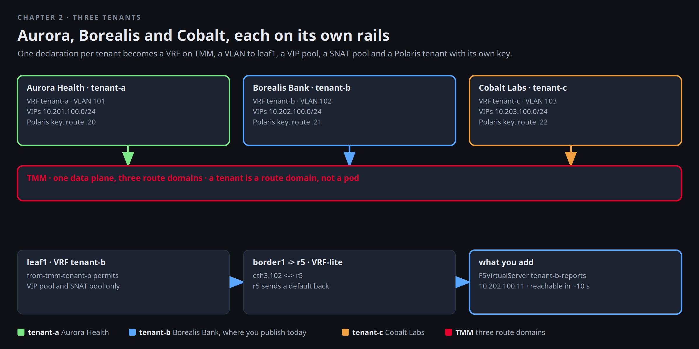

# Three tenants

Tuesday. Aurora Health's network team sends Mira a one line question: "Where exactly does our traffic stop being
ours?" Borealis Bank asks the same thing in forty lines with a diagram attached. Cobalt Labs does not ask. They
assume. Mira's answer is the same for all three, and it is not a policy document. It is a tenant: one declaration on
BNK that becomes a route domain on TMM, a VLAN on the handoff, a VRF on every switch, a VIP pool, a SNAT pool, and a
tenant in the AI Gateway with its own key. This chapter reads one tenant through every layer, proves the walls
between them, and then publishes something new for Borealis so you see the whole chain move.



[button label="Open the Lab Topology" variant="outline"](tab-3)

In the **Lab Topology** tab, **A client reaches a tenant VIP** is the flow you extend at the end of this chapter,
and **A tenant pod leaves the factory** is the one you test in the middle.

## One tenant, every layer

Start with Aurora, `tenant-a`. Everything the tenant is on BNK fits in a short list of objects, and the manifest
that created them is in the lab repo:

```bash,run
kubectl -n f5-bnk get vrf tenant-a f5-spk-vlans fab-a routingconfig tenant-a f5virtualserver tenant-a-vip f5-spk-egresses tenant-a-egress f5-spk-snatpools tenant-a-snat
sed -n '/name: tenant-a$/,/snat: {type: automap}/p' $LAB_ROOT/manifests/bnk/40-tenants.yaml
```

Read the manifest top to bottom: a `Vrf` with its own route domain id, a VLAN leg on interface 1.1 tagged 101 with
self IP `172.17.101.11`, a `RoutingConfig` that peers with leaf1 inside that VRF, a virtual server, an egress and a
SNAT pool. Nothing here mentions Borealis or Cobalt. That is the point.

TMM holds all of it as one route domain. Ask its routing stack for the tenant's own table:

```bash,run
P=$(kubectl -n f5-bnk get pod -l app=f5-tmm -o jsonpath='{.items[0].metadata.name}')
kubectl -n f5-bnk exec $P -c f5-tmm-routing -- imish -e 'show ip bgp summary' | grep -E 'Neighbor|172.17.101'
kubectl -n f5-bnk exec $P -c f5-tmm-routing -- imish -e 'show ip route' | grep -E '101\.1|10\.201' | head -6
```

The peer on `172.17.101.1` is leaf1's VLAN 101 address. The routes TMM learned from it are the default and the
client subnet. The routes TMM announces are below.

## What the fabric accepts

leaf1 peers with TMM inside VRF tenant-a and accepts exactly two prefixes from it: the tenant's VIP pool and its SNAT
pool. Everything else TMM might announce into that session is dropped by a prefix-list:

```bash,run
docker exec leaf1 vtysh -c 'show bgp vrf tenant-a summary' | sed -n '/Neighbor/,$p'
docker exec leaf1 vtysh -c 'show ip bgp vrf tenant-a' | grep -E '^\*|Network'
docker exec leaf1 vtysh -c 'show running-config' | grep -A3 'prefix-list from-tmm-tenant-a'
```

Two `/24`s and the `/32`s inside them, nothing else. border1 does the same towards r5 on the tenant's VLAN-tagged
sub-interface, so r5 sees Aurora only as those two prefixes, arriving on one link:

```bash,run
docker exec border1 vtysh -c 'show running-config' | grep -A3 'prefix-list to-r5-tenant-a'
docker exec r5 vtysh -c 'show ip bgp neighbors 172.16.201.1 routes' | grep -E '^\*|Network'
```

Open the **Lab Topology** tab and step through **A client reaches a tenant VIP**: the hop list is the list of tables
you just read.

## The walls

Three things must be true for the customers to believe the slide. The client reaches Aurora's VIP through r5.
Aurora's pod cannot reach Cobalt's. Cobalt's pod cannot open anything into Aurora's namespace.

```bash,run
docker exec client curl -s -m 5 http://10.201.100.10/ | head -3
kubectl -n tenant-a exec deploy/hello -- sh -c 'wget -q -O- -T 3 http://hello.tenant-c.svc.cluster.local/ 2>&1 | head -2 || echo "tenant-a -> tenant-c: refused"'
kubectl -n tenant-c exec deploy/hello -- sh -c 'wget -q -O- -T 3 http://hello.tenant-a.svc.cluster.local/ 2>&1 | head -2 || echo "tenant-c -> tenant-a: refused"'
```

The cross-namespace calls are refused by Calico NetworkPolicy, which is the cluster's wall. The fabric's wall is the
VRF, and you see it when a pod leaves.

## Leaving the factory

When Aurora's pod opens a connection to the outside, it does not go through the node's default route. The
`F5SPKEgress` for the namespace steers it into a tunnel to TMM, TMM puts it in route domain tenant-a, SNATs it from
Aurora's pool, and sends it to leaf1 on VLAN 101. r5 sees `10.201.200.x`, never a pod address. Watch it arrive in
**Terminal 2** first:

```bash,run
docker exec r5 sh -c 'command -v tcpdump >/dev/null || apk add --no-cache tcpdump >/dev/null 2>&1; echo "tcpdump ready on r5"'
```

In Terminal 2:

```
docker exec r5 tcpdump -ni eth1.101 -c 4 'tcp port 80'
```

Back here, send the connection from Aurora's pod to the client:

```bash,run
kubectl -n tenant-a exec deploy/hello -- sh -c 'wget -q -O- -T 5 http://172.16.250.10/ >/dev/null 2>&1; echo "left the factory: exit $?"'
docker exec r5 vtysh -c 'show ip route 10.201.200.0/24'
```

Terminal 2 shows the SYN from a `10.201.200.x` address on the tenant-a sub-interface. The client has no web server, so
the exit code is non-zero, and that is fine. The packet is what you wanted to see. The route r5 holds for that SNAT
pool is the return path, and it points at the tenant-a link only. Step through **A tenant pod leaves the factory**
in the Lab Topology tab with the capture still on the screen.

## Publish a second service for Borealis Bank

Borealis's team wants a reports endpoint next to their hello page. On BNK that is one object. The pool already exists
(`tenant-b-hello`, with its members in `f5-bnk`). You add the `F5VirtualServer` in VRF tenant-b:

```bash,run
cat <<'EOF' | kubectl apply -f -
apiVersion: k8s.f5net.com/v1
kind: F5VirtualServer
metadata: {name: tenant-b-reports, namespace: f5-bnk}
spec:
  destinationAddress: 10.202.100.11
  destinationPort: 80
  vrf: tenant-b
  pool: tenant-b-hello
  routeAdvertisement: true
  snat: {type: automap}
EOF
```

`routeAdvertisement: true` is what makes the fabric learn it. Within a few seconds TMM announces the `/32` to leaf1
inside VRF tenant-b, leaf1 exports it as an EVPN type-5, border1 imports it into its own VRF tenant-b and passes it
to r5 over the VLAN 102 sub-interface:

```bash,run
sleep 10
docker exec leaf1 vtysh -c 'show ip bgp vrf tenant-b 10.202.100.11/32' | sed -n '1,10p'
docker exec border1 vtysh -c 'show bgp l2vpn evpn route type prefix' | grep -B1 '10.202.100.11'
docker exec r5 vtysh -c 'show ip route 10.202.100.11'
```

And the client, behind r5, can call it:

```bash,run
docker exec client curl -s -m 5 -o /dev/null -w 'client -> 10.202.100.11: HTTP %{http_code}\n' http://10.202.100.11/
docker exec client curl -s -m 5 http://10.202.100.11/ | head -3
```

Nothing changed on any switch. That is the operational promise of the tenant model: a customer's service is a
Kubernetes object, and the fabric follows.

## The tenant in the AI Gateway

The same three names exist in Polaris, the AI Gateway console. Each is a tenant with its own providers, models, keys
and a route on its own VIP. Open the **Polaris** tab, sign in with the password from chapter 1, and look at
`tenant-a`, `tenant-b` and `tenant-c` in turn.

[button label="Open Polaris" variant="success"](tab-2)

From the terminal, a request through Borealis's route with Borealis's key:

```bash,run
K=$(cat /root/.bnk/aigw/tenant-b.key)
docker exec client curl -s -m 120 http://172.16.100.21/v1/chat/completions -H "Authorization: Bearer $K" -H 'Content-Type: application/json' \
  -d '{"model":"tenant-b-qwen2.5-1.5b","messages":[{"role":"user","content":"In one sentence, what is a VRF?"}],"max_tokens":60}' | jq -r '.choices[0].message.content'
```

A CPU model answers in a few seconds. The same key on Aurora's route, one address over, is refused before any model is
involved, because keys belong to a tenant:

```bash,run
docker exec client curl -s -m 20 http://172.16.100.20/v1/chat/completions -H "Authorization: Bearer $K" -H 'Content-Type: application/json' \
  -d '{"model":"tenant-b-qwen2.5-1.5b","messages":[{"role":"user","content":"hi"}]}' | jq -c '{error: (.error.message // .error // "none")}'
unset K
```

In Polaris, the refused call shows up under `tenant-a` as a failed authentication. Mira's reply to all three
customers is the list of objects in this chapter and the sentence under the picture: a tenant is a route domain,
not a pod.

## Checkpoint

Before clicking **Check**: the `F5VirtualServer` `tenant-b-reports` exists, r5 has a route to `10.202.100.11`, and
the client gets a 200 from it. The check verifies those three.
