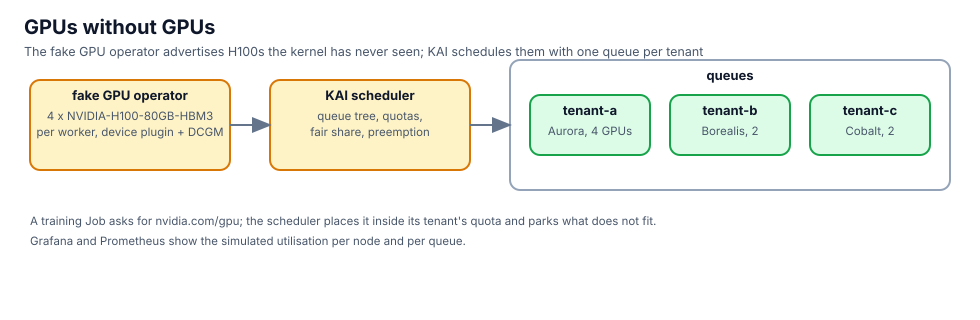

## The GPUs the cluster thinks it has

```bash,run
kubectl get nodes -o custom-columns='NODE:.metadata.name,GPU:.status.allocatable.nvidia\.com/gpu,PRODUCT:.metadata.labels.nvidia\.com/gpu\.product'
kubectl get queues.scheduling.run.ai -o custom-columns='QUEUE:.metadata.name,PARENT:.spec.parentQueue,QUOTA:.spec.resources.gpu.quota,LIMIT:.spec.resources.gpu.limit,WEIGHT:.spec.resources.gpu.overQuotaWeight'
```

Aurora is guaranteed 4, Borealis and Cobalt 2 each; any of them may borrow idle GPUs (`limit: -1`), and Aurora's
borrowing weight is double.

## Submit work per tenant

A job that asks for GPUs, scheduled by KAI, in a tenant's queue:

```bash,run
gpu_job() {   # tenant gpus
cat <<EOF | kubectl apply -f -
apiVersion: batch/v1
kind: Job
metadata: {name: train-$RANDOM, namespace: tenant-$1, labels: {kai.scheduler/queue: tenant-$1}}
spec:
  template:
    metadata: {labels: {kai.scheduler/queue: tenant-$1}}
    spec:
      schedulerName: kai-scheduler
      restartPolicy: Never
      containers:
      - name: train
        image: python:3.12-slim
        command: [sh, -c, "echo training on \$NVIDIA_VISIBLE_DEVICES; sleep 600"]
        resources: {limits: {nvidia.com/gpu: "$2"}}
EOF
}
gpu_job a 4; gpu_job b 2; gpu_job c 2
sleep 15; kubectl get pods -A -l kai.scheduler/queue -o custom-columns='NS:.metadata.namespace,POD:.metadata.name,STATUS:.status.phase,NODE:.spec.nodeName'
```

All eight GPUs are in use. Now Cobalt asks for four more; it is over its quota and nothing is idle, so it waits:

```bash,run
gpu_job c 4
sleep 15; kubectl -n tenant-c get pods -o custom-columns='POD:.metadata.name,STATUS:.status.phase'
kubectl -n tenant-c get events --field-selector reason=Unschedulable -o custom-columns='MSG:.message' | tail -3
```

Free Aurora's job and watch Cobalt's pending job take the GPUs. Aurora can reclaim them at any time: its quota is
guaranteed, Cobalt's extra ones are borrowed.

```bash,run
kubectl -n tenant-a delete jobs --all
sleep 20; kubectl get pods -A -l kai.scheduler/queue -o custom-columns='NS:.metadata.namespace,POD:.metadata.name,STATUS:.status.phase'
```

## What a pod sees

Inside a scheduled pod the GPU looks real:

```bash,run
P=$(kubectl -n tenant-c get pods -l kai.scheduler/queue --field-selector status.phase=Running -o name | head -1)
kubectl -n tenant-c exec $P -- sh -c 'echo "devices: $NVIDIA_VISIBLE_DEVICES"; nvidia-smi 2>/dev/null | head -12 || echo "(no nvidia-smi binary in this image; the device is in the environment)"'
```

## The model workers

The mocker's workers publish vLLM's metrics. Prometheus scrapes them; Grafana shows them (admin, password below):

```bash,run
kubectl -n aigw-models get pods -o wide
cat /root/.bnk/grafana-admin; echo
```

Open the **Grafana** tab, Explore, and query `vllm:num_requests_running` and `DCGM_FI_DEV_GPU_UTIL`. Both exist
without a single GPU in the VM.

Clean up the jobs, then click **Check**:

```bash,run
for t in a b c; do kubectl -n tenant-$t delete jobs --all --ignore-not-found; done
```
