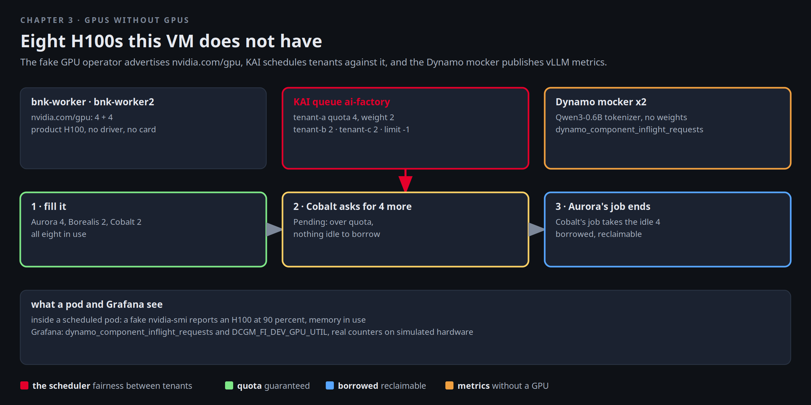

# GPUs without GPUs

Cobalt Labs signed for GPUs before anything else, and their first ticket is about fairness: "If Aurora is idle at
night, do we get their cards?" Mira's factory has an answer, and she can show it on a VM that does not contain a
single GPU. The fake GPU operator advertises eight H100s to the cluster, NVIDIA's KAI scheduler divides them into
queues with quotas and borrowing, and the Dynamo mocker publishes the same vLLM metrics a real worker would. The
scheduling decisions are real. Only the silicon is missing.



[button label="Open the Lab Topology" variant="outline"](tab-4)

Nothing in this chapter crosses the fabric, so the Lab Topology tab is a map of where things sit: the mocker and the
GPU jobs land on `bnk-worker2`, the node with the workload label.

## The GPUs the cluster thinks it has

```bash,run
kubectl get nodes -o custom-columns='NODE:.metadata.name,GPU:.status.allocatable.nvidia\.com/gpu,PRODUCT:.metadata.labels.nvidia\.com/gpu\.product'
kubectl -n gpu-operator get pods -o wide --no-headers | awk '{printf "%-50s %-10s %s\n", $1, $3, $7}'
```

Four per worker, product `H100`, from a device plugin that has no driver underneath it. The scheduler does not know
the difference, and neither does KAI.

## The queues

KAI organises GPUs as a tree of queues. Northlight has one parent, `ai-factory`, and one child per tenant:

```bash,run
kubectl get queues.scheduling.run.ai -o custom-columns='QUEUE:.metadata.name,PARENT:.spec.parentQueue,QUOTA:.spec.resources.gpu.quota,LIMIT:.spec.resources.gpu.limit,WEIGHT:.spec.resources.gpu.overQuotaWeight'
kubectl -n kai-scheduler get pods --no-headers | awk '{print $1, $3}'
```

Aurora is guaranteed four, Borealis and Cobalt two each. `limit: -1` means any of them may borrow idle GPUs above
its quota, and Aurora's over-quota weight of 2 means that when two tenants compete for the same idle cards, Aurora
gets twice the share. Those three numbers are the whole fairness policy.

## Submit work per tenant

A job that asks for GPUs, scheduled by KAI into a tenant's queue. The function below is the only thing you need for
the rest of the chapter:

```bash,run
gpu_job() {   # tenant gpus
cat <<EOF | kubectl apply -f -
apiVersion: batch/v1
kind: Job
metadata: {name: train-$RANDOM, namespace: tenant-$1, labels: {kai.scheduler/queue: tenant-$1}}
spec:
  template:
    metadata: {labels: {kai.scheduler/queue: tenant-$1}}
    spec:
      schedulerName: kai-scheduler
      restartPolicy: Never
      terminationGracePeriodSeconds: 2
      containers:
      - name: train
        image: python:3.12-slim
        command: [sh, -c, "echo training on \$NVIDIA_VISIBLE_DEVICES; sleep 600"]
        resources: {limits: {nvidia.com/gpu: "$2"}}
EOF
}
gpu_job a 4; gpu_job b 2; gpu_job c 2
sleep 15; kubectl get pods -A -l kai.scheduler/queue -o custom-columns='NS:.metadata.namespace,POD:.metadata.name,STATUS:.status.phase,NODE:.spec.nodeName'
```

Three jobs, eight GPUs, all `Running`. Keep **Terminal 2** on the queue view while you do the next two steps:

```
watch -n 3 'kubectl get pods -A -l kai.scheduler/queue -o custom-columns=NS:.metadata.namespace,POD:.metadata.name,STATUS:.status.phase'
```

## Over quota, nothing idle

Now Cobalt asks for four more. It is above its quota of two and there is nothing idle to borrow, so the job waits,
and KAI says why:

```bash,run
gpu_job c 4
sleep 15; kubectl -n tenant-c get pods -o custom-columns='POD:.metadata.name,STATUS:.status.phase'
kubectl -n tenant-c get events --field-selector reason=Unschedulable -o custom-columns='MSG:.message' | tail -3
```

`Pending`, with an event that names the parent queue, its limit of eight, the eight allocated and the four asked for. Nothing was preempted: Borealis's two GPUs are
inside Borealis's quota and Aurora's four are inside Aurora's.

## Borrowing

Aurora's job ends. Four GPUs go idle, and Cobalt's pending job takes them, above its quota, because its limit allows
it:

```bash,run
kubectl -n tenant-a delete jobs --all
kubectl -n tenant-a wait --for=delete pod -l kai.scheduler/queue --timeout=60s 2>/dev/null
for i in $(seq 1 12); do [ "$(kubectl -n tenant-c get pods -l kai.scheduler/queue --field-selector status.phase=Pending --no-headers 2>/dev/null | wc -l)" = 0 ] && break; sleep 5; done
kubectl get pods -A -l kai.scheduler/queue -o custom-columns='NS:.metadata.namespace,POD:.metadata.name,STATUS:.status.phase'
```

Cobalt now holds six: two guaranteed and four borrowed. Aurora comes back with a four GPU job. Its quota is
guaranteed, so KAI reclaims the borrowed cards from Cobalt's over-quota job:

```bash,run
gpu_job a 4
for i in $(seq 1 18); do [ "$(kubectl -n tenant-a get pods -l kai.scheduler/queue --field-selector status.phase=Running --no-headers 2>/dev/null | wc -l)" = 1 ] && break; sleep 5; done
kubectl get pods -A -l kai.scheduler/queue -o custom-columns='NS:.metadata.namespace,POD:.metadata.name,STATUS:.status.phase,NODE:.spec.nodeName'
kubectl -n tenant-c get events --sort-by=.lastTimestamp -o custom-columns='REASON:.reason,MSG:.message' | grep -iE 'preempt|reclaim|evict' | tail -3
```

Aurora's job is `Running` again and one of Cobalt's is gone or back to `Pending`, with an event in tenant-c that
names the reclaim.

That is the answer to Cobalt's ticket: yes, you get Aurora's idle cards at night, and yes, Aurora gets them back in
the morning.

## What a pod sees

Inside a scheduled pod the GPU looks real to the application: the fake operator injects an `nvidia-smi` that reports
an H100 with memory in use and load on it, and nothing in the pod can tell the difference:

```bash,run
P=$(kubectl get pods -A -l kai.scheduler/queue --field-selector status.phase=Running -o jsonpath='{.items[0].metadata.namespace}/{.items[0].metadata.name}')
kubectl -n ${P%/*} exec ${P#*/} -- sh -c 'nvidia-smi 2>/dev/null | head -12 || echo "(no nvidia-smi in this pod)"; echo "NVIDIA_VISIBLE_DEVICES=${NVIDIA_VISIBLE_DEVICES:-unset}"'
kubectl -n ${P%/*} logs ${P#*/} | head -2
```

## The model workers and their metrics

The Dynamo mocker is a worker that loads a tokenizer and no weights. It answers with filler text, so token counts
are real counts on simulated text, and it publishes Dynamo's component metrics, which Prometheus scrapes:

```bash,run
kubectl -n aigw-models get pods -o wide --no-headers | awk '{printf "%-44s %-10s %s\n", $1, $3, $7}'
curl -sG http://127.0.0.1:30909/api/v1/query --data-urlencode 'query=sum by (pod) (dynamo_component_inflight_requests)' | python3 -c 'import json,sys; [print(" ", r["metric"].get("pod","?"), "in flight:", r["value"][1]) for r in json.load(sys.stdin)["data"]["result"]]'
curl -s 'http://127.0.0.1:30909/api/v1/query?query=DCGM_FI_DEV_GPU_UTIL' | python3 -c 'import json,sys; d=json.load(sys.stdin)["data"]["result"]; print("  DCGM series:", len(d))'
```

Open the **Grafana** tab (user `admin`, password below), go to Explore, and query `dynamo_component_inflight_requests` and
`DCGM_FI_DEV_GPU_UTIL`. Both exist without a GPU in the VM.

```bash,run
cat /root/.bnk/grafana-admin; echo
```

[button label="Open Grafana" variant="success"](tab-2)

## Clean up

Delete the jobs so the GPUs are free for the picker in the next chapter, and stop the watch in Terminal 2:

```bash,run
for t in a b c; do kubectl -n tenant-$t delete jobs --all --ignore-not-found; done
kubectl get jobs -A -l kai.scheduler/queue --no-headers 2>/dev/null | wc -l | sed 's/^/GPU jobs left: /'
```

## Checkpoint

The check verifies the cluster advertises eight GPUs, the four KAI queues exist, and no GPU jobs are left.
