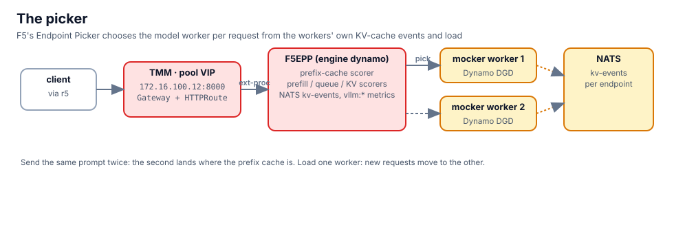

## The pool and its picker

```bash,run
kubectl -n aigw-models get inferencepool model-pool -o yaml | sed -n '/^spec:/,/^status:/p'
kubectl -n aigw-models get f5epp model-pool-epp -o jsonpath='{.spec.engine}{" "}{.spec.poolRef.name}{" "}{.status.conditions[-1].type}={.status.conditions[-1].status}{"\n"}'
kubectl -n aigw-models get cm model-pool-epp-config -o jsonpath='{.data.pool\.yaml}' | grep -E '^- name:|type:' | paste - - | column -t
```

The generated plugin list is the picker's scoring pipeline: `queue-scorer`, `f5-prefix-cache-scorer`,
`f5-prefill-load-scorer`, `f5-predictive-load-scorer`, `kv-cache-utilization-scorer`, `hcl-picker`.

## Watch a pick

The pool VIP is `172.16.100.12:8000`. Send one prompt, then the same prompt again, and read which worker the
picker named each time (the picker logs its choice; TMM forwards to exactly that pod):

```bash,run
P=$(kubectl -n aigw-models get pods -l app=model-pool-epp -o name 2>/dev/null | head -1); [ -n "$P" ] || P=$(kubectl -n aigw-models get pods -o name | grep epp | head -1)
ask() { docker exec client curl -s -m 60 http://172.16.100.12:8000/v1/chat/completions -H 'Content-Type: application/json' \
  -d "{\"model\":\"Qwen/Qwen3-0.6B\",\"messages\":[{\"role\":\"user\",\"content\":\"$1\"}],\"max_tokens\":32}" | jq -r '.choices[0].message.content // .error' | head -c 120; echo; }
ask "Describe the water cycle in three sentences for a ten year old."
sleep 2
ask "Describe the water cycle in three sentences for a ten year old."
kubectl -n aigw-models logs $P --since=2m | grep -iE 'pick|select|endpoint' | tail -6
```

The second request has a prefix the first one already pushed into one worker's cache, so the prefix-cache scorer
pulls it to that worker. A different prompt is free to go to the other one:

```bash,run
ask "List four prime numbers above 100."
kubectl -n aigw-models logs $P --since=1m | grep -iE 'pick|select|endpoint' | tail -3
```

## Load-aware

Put one worker under load and the picker steers new requests to the other. Open the **Prometheus** tab and graph
`vllm:num_requests_running` while this runs:

```bash,run
for i in $(seq 1 12); do ask "Write a 200 word story about a lighthouse keeper, variation $i." >/dev/null & done; sleep 3
ask "What is the capital of Norway?"
wait
kubectl -n aigw-models logs $P --since=1m | grep -iE 'pick|select|endpoint' | tail -4
```

## Disaggregated mode

The `F5EPP` has a `mode` field: `aggregated` (every worker handles a request end to end, what runs here) or
`disaggregated` (the pool is split by label into prefill and decode workers, and the picker chooses one of each).
Read the field's description; it is the P/D contract chapter 13 compares with llm-d:

```bash,run
kubectl explain f5epp.spec.mode | sed -n '1,20p'
```

Click **Check** when the picker has logged at least one choice.
