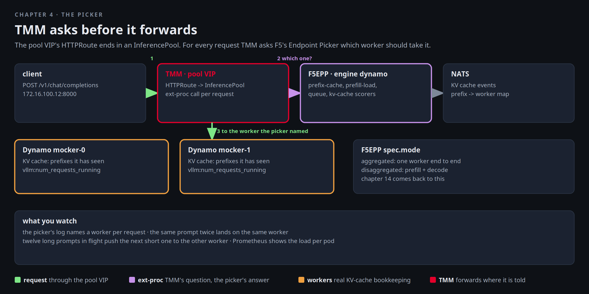

# The picker

Aurora's clinical assistant is in pilot and its prompts share a long system prefix. Every time one of those prompts
lands on a worker that has never seen the prefix, the worker has to prefill it from scratch, and the customer
notices the pause. The engineer who runs the models asks Mira a question load balancers usually cannot answer:
"Can the gateway send the request to the worker that already has the cache?" In this factory it can. The pool VIP's
route does not end in a Service. It ends in an `InferencePool`, and for every request TMM asks F5's Endpoint Picker
which worker should take it.



[button label="Open the Lab Topology" variant="outline"](tab-4)

The **Lab Topology** tab opens on **The pool VIP and the picker**: three hops, with the question and the answer drawn
as the dashed line between TMM and the picker.

## The pool and its picker

Three objects. An `InferencePool` that selects the worker pods, an `F5EPP` that runs the picker for it, and the
ConfigMap the picker generated with its scoring pipeline:

```bash,run
kubectl -n aigw-models get inferencepool model-pool -o yaml | sed -n '/^spec:/,/^status:/p'
kubectl -n aigw-models get f5-epps model-pool-epp -o jsonpath='{.spec.engine}{" "}{.spec.poolRef.name}{" "}{.status.conditions[-1].type}={.status.conditions[-1].status}{"\n"}'
kubectl -n aigw-models get cm model-pool-epp-config -o jsonpath='{.data.pool\.yaml}' | grep -E '^- name:|type:' | paste - - | column -t
```

The plugin list is the pipeline: `queue-scorer`, `f5-prefix-cache-scorer`, `f5-prefill-load-scorer`,
`f5-predictive-load-scorer`, `kv-cache-utilization-scorer`, and `hcl-picker`, which turns the scores into one name.
The engine is `dynamo`, which means the prefix-cache scorer is fed by KV events the workers publish on NATS, not by
guessing from request history:

```bash,run
kubectl -n aigw-models get f5-epps model-pool-epp -o jsonpath='{.spec.natsURL}{"\n"}'
kubectl -n aigw-models get pods -o wide --no-headers | awk '{printf "%-44s %-10s %s\n", $1, $3, $7}'
```

And the route that puts the picker in the path. The pool VIP is `172.16.100.12:8000`, a BNK Gateway with an
HTTPRoute whose backend is the InferencePool:

```bash,run
kubectl -n aigw-models get gateway,httproute
kubectl -n aigw-models get httproute -o jsonpath='{range .items[*]}{.metadata.name}: {range .spec.rules[*].backendRefs[*]}{.kind}/{.name} {end}{"\n"}{end}'
```

## Watch a pick

The picker does not write its choice to its log at the default verbosity. The workers do count what they serve,
and that is the better witness: each decode worker publishes `dynamo_component_requests_total`, and reading it
inside the pod before and after a request shows exactly which worker took it. Two helpers, `counts` and `ask`:

```bash,run
counts() { for p in $(kubectl -n aigw-models get pods -o name | grep mocker-decode); do
  n=$(kubectl -n aigw-models exec $p -c main -- python3 -c "import urllib.request as u; print(u.urlopen('http://127.0.0.1:9090/metrics', timeout=5).read().decode())" 2>/dev/null | awk '/^dynamo_component_requests_total/{s+=$NF} END{print s+0}')
  echo "  ${p#pod/}: $n requests served"; done; }
ask() { docker exec client curl -s -m 60 http://172.16.100.12:8000/v1/chat/completions -H 'Content-Type: application/json' \
  -d "{\"model\":\"Qwen/Qwen3-0.6B\",\"messages\":[{\"role\":\"user\",\"content\":\"$1\"}],\"max_tokens\":32}" | jq -r '.choices[0].message.content // .error' | head -c 80; echo; }
counts
```

Now one prompt, then the same prompt again. Keep **Terminal 2** on the picker's log meanwhile: every request shows
up as "EPP received request" and "EPP sent request body response(s) to proxy" with its request id, which is TMM
asking and the picker answering:

```
P=$(kubectl -n aigw-models get pods -o name | grep epp | head -1); kubectl -n aigw-models logs -f $P | grep --line-buffered -E 'EPP (received|sent)'
```

```bash,run
ask "Describe the water cycle in three sentences for a ten year old."; counts
sleep 2
ask "Describe the water cycle in three sentences for a ten year old."; counts
```

The mocker answers with filler text, which is what it is for. The counters are the point. The second request has
a prefix the first one pushed into one worker's KV cache, so the prefix-cache scorer pulls it to that worker: the
same counter moves twice. A different prompt has no such pull and is free to go to the other one:

```bash,run
ask "List four prime numbers above 100."; counts
```

This is the answer to Aurora's engineer. The gateway did not hash on a header or round-robin. It asked.

## Load-aware

Cache is one signal. Load is the other. Put the workers under a burst of long prompts and read the counters: the
picker spreads the burst, and the next short question goes to whichever worker has less in flight. Open the
**Prometheus** tab and graph `rate(dynamo_component_requests_total[1m])` while this runs:

[button label="Open Prometheus" variant="success"](tab-2)

```bash,run
counts
for i in $(seq 1 12); do ask "Write a 200 word story about a lighthouse keeper, variation $i." >/dev/null & done; sleep 3
ask "What is the capital of Norway?"
wait; counts
```

Both counters moved, and the burst was not sent to one worker only: the prefill-load and queue scorers outweighed
the cache scorer, which had nothing to say for twelve different prompts. The mocker answers in milliseconds, so
`dynamo_component_inflight_requests` is almost always zero when you look. The rate of the total is the graph that
shows the burst.

## TMM's side of it

The ext-proc conversation is invisible to the client. A Gateway API route is programmed into TMM directly, so there
is no `F5VirtualServer` object to read for it. What there is: the Gateway's listener with the route attached, and
the InferencePool's status, which says the picker reference resolved and the parent accepted it:

```bash,run
kubectl -n f5-bnk get gateway pool-vip -o jsonpath='{.spec.addresses[0].value}: {range .status.listeners[*]}{.name} attachedRoutes={.attachedRoutes}{"\n"}{end}'
kubectl -n aigw-models get inferencepool model-pool -o jsonpath='{range .status.parents[0].conditions[*]}{.type}={.status} {.message}{"\n"}{end}'
```

## Disaggregated mode

The `F5EPP` has a `mode` field: `aggregated`, where every worker handles a request end to end, which is what runs
here, or `disaggregated`, where the pool is split by label into prefill and decode workers and the picker chooses one
of each. Read the field's description now. Chapter 14 comes back to it when the question is whether the picker knows
where a worker sits:

```bash,run
kubectl explain f5-epps.spec.mode | sed -n '1,20p'
```

## Checkpoint

The check sends one request through the pool VIP and expects a 200, and expects at least one decode worker's own
request counter to show that it has served something.
