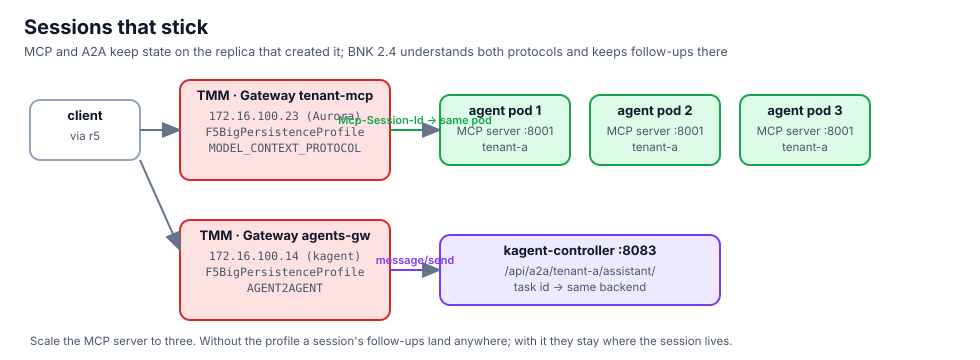

## Publish Aurora's MCP server on BNK

Aurora's app has an MCP sidecar on port 8001 (the tools its assistant uses). It is reachable inside the cluster only.
Give it a BNK Gateway of its own in Aurora's namespace, on `172.16.100.23`, with an HTTPRoute for `/mcp`:

```bash,run
sed -n '/kind: Gateway/,/kind: HTTPRoute/p' $LAB_ROOT/manifests/chapters/05-mcp-route.yaml | head -20
kubectl apply -f $LAB_ROOT/manifests/chapters/05-mcp-route.yaml 2>&1 | grep -v persistence
kubectl -n tenant-a wait --for=condition=Programmed gateway/tenant-mcp --timeout=180s
kubectl -n tenant-a get gateway tenant-mcp httproute tenant-mcp
```

The apply also created the persistence profile and its NetPolicy, which stay unprogrammed until the passphrase
Secret exists. First, the problem they solve.

## Scale, then watch sessions scatter

An MCP client starts with `initialize` and gets a session id back. Every later call carries it. Three replicas, one
session, six tool calls, and the pod that answers each time:

```bash,run
kubectl -n tenant-a scale deploy/agent --replicas=3 && kubectl -n tenant-a rollout status deploy/agent --timeout=180s
mcp() {   # one MCP call through the client: $1 = session id or "", $2 = JSON-RPC body
  docker exec client curl -s -m 10 -D /tmp/h -o /tmp/b http://172.16.100.23/mcp -H 'Content-Type: application/json' \
    -H 'Accept: application/json, text/event-stream' ${1:+-H "Mcp-Session-Id: $1"} -d "$2" >/dev/null
  docker exec client sh -c 'cat /tmp/h /tmp/b'
}
SID=$(mcp "" '{"jsonrpc":"2.0","id":1,"method":"initialize","params":{"protocolVersion":"2025-03-26","capabilities":{},"clientInfo":{"name":"lab","version":"1"}}}' | grep -i '^Mcp-Session-Id' | awk '{print $2}' | tr -d '\r')
echo "session $SID"
for i in 1 2 3 4 5 6; do
  mcp "$SID" '{"jsonrpc":"2.0","id":2,"method":"tools/call","params":{"name":"tenant_identity","arguments":{}}}' | grep -oE 'agent-[0-9a-f]+-[0-9a-z]+' | head -1
done | sort | uniq -c
```

Without persistence, the six calls spread over two or three pods. The MCP server in this lab is tolerant of that; a
real one that keeps session state in memory answers `404 session not found` for every call that lands elsewhere.

## Turn the profile on

The profile encrypts the session cookie it issues with a passphrase from a Secret. Create the Secret; BNK programs
the profile within seconds:

```bash,run
kubectl -n tenant-a create secret generic mcp-passphrase --from-literal=primary-passphrase="$(python3 -c 'import secrets; print(secrets.token_urlsafe(24))')" --dry-run=client -o yaml | kubectl apply -f -
sleep 10
kubectl -n tenant-a get f5bigpersistenceprofile tenant-mcp-sessions netpolicy tenant-mcp-sessions
kubectl -n tenant-a get f5bigpersistenceprofile tenant-mcp-sessions -o jsonpath='{.status.conditions[-1].message}{"\n"}'
```

Same measurement, new session:

```bash,run
SID=$(mcp "" '{"jsonrpc":"2.0","id":1,"method":"initialize","params":{"protocolVersion":"2025-03-26","capabilities":{},"clientInfo":{"name":"lab","version":"1"}}}' | grep -i '^Mcp-Session-Id' | awk '{print $2}' | tr -d '\r')
echo "session $SID"
for i in 1 2 3 4 5 6; do
  mcp "$SID" '{"jsonrpc":"2.0","id":2,"method":"tools/call","params":{"name":"tenant_identity","arguments":{}}}' | grep -oE 'agent-[0-9a-f]+-[0-9a-z]+' | head -1
done | sort | uniq -c
```

One pod, six times. TMM read the session id from the protocol, not from a cookie the app had to set.

## The same for A2A

The tenant assistants answer A2A on the agents gateway (`172.16.100.14`, chapter 9 uses it in anger). A2A has the
same shape of problem: a `message/send` creates a task, `tasks/get` must find it. The profile type is `AGENT2AGENT`:

```bash,run
kubectl -n kagent create secret generic a2a-passphrase --from-literal=primary-passphrase="$(python3 -c 'import secrets; print(secrets.token_urlsafe(24))')" --dry-run=client -o yaml | kubectl apply -f -
kubectl apply -f $LAB_ROOT/manifests/chapters/05-a2a-persistence.yaml
sleep 10; kubectl -n kagent get f5bigpersistenceprofile agents-a2a-sessions netpolicy agents-a2a-sessions
docker exec client curl -s -m 10 http://172.16.100.14/api/a2a/tenant-a/assistant/.well-known/agent-card.json | python3 -m json.tool | head -20
```

The kagent controller runs as one replica here, so there is nothing to scatter yet; the profile is in place for when
there are more, and chapter 9's calls already go through it.

## What you saw

- A Gateway per tenant service, in the tenant's namespace, on an address from BNK's pool.
- `NetPolicy` is the attachment: the Gateway listener on one side, a BNK extension on the other. Chapter 6 attaches
  an iRule the same way; chapter 11 attaches the guardrail.
- Two persistence types that read the protocol. The Polaris routes do not need them (one request, one answer); MCP
  servers and A2A agents do.
