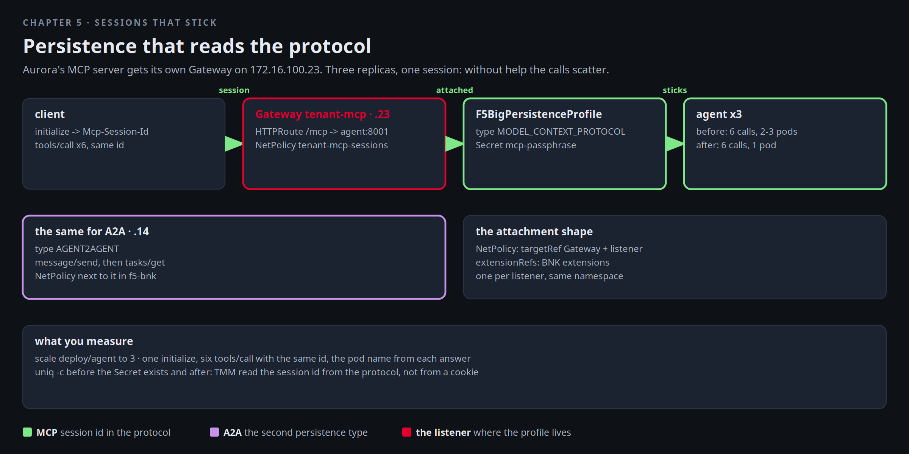

# Sessions that stick

Aurora's developers have put their clinical tools behind an MCP server, a sidecar on port 8001 next to the
assistant. It works with one replica. The night they scale to three, every third tool call starts failing with
"session not found", because an MCP session lives in the memory of the pod that created it, and a plain load
balancer has no idea which pod that was. Their ticket to Mira is short: "Make the sessions stick." BNK's answer is
not a cookie. It is a persistence profile that reads the protocol itself.



[button label="Open the Lab Topology" variant="outline"](tab-2)

The **Lab Topology** tab opens on **MCP and A2A sessions stick**. The first two hops are this chapter. The third is
the same idea on the agents gateway.

## Publish Aurora's MCP server on BNK

The MCP sidecar is reachable inside the cluster only. Give it a BNK Gateway of its own on an address from the pool.
The Gateway is published by the platform team in BNK's namespace, with its listener open to routes from Aurora's
namespace, and Aurora owns the HTTPRoute for `/mcp` in its own namespace, the same shape as the pool VIP. The
manifest also carries the persistence profile and the NetPolicy that attaches it, next to the Gateway in `f5-bnk`;
they stay unprogrammed until a passphrase Secret exists there. Read it before you apply it:

```bash,run
grep -nE '^kind:|^  name:|destinationAddress|value: 172|type: MODEL|passphrase|targetRef|extensionRef' $LAB_ROOT/manifests/chapters/05-mcp-route.yaml
kubectl apply -f $LAB_ROOT/manifests/chapters/05-mcp-route.yaml 2>&1 | grep -v persistence
kubectl -n f5-bnk wait --for=condition=Programmed gateway/tenant-mcp --timeout=180s
kubectl -n f5-bnk get gateway/tenant-mcp; kubectl -n tenant-a get httproute/tenant-mcp
```

`Programmed=True` means TMM has the listener. From the client, behind r5, the route answers an MCP `initialize` with a
session id in a response header:

```bash,run
docker exec client curl -s -m 10 -D - -o /dev/null http://172.16.100.23/mcp -H 'Content-Type: application/json' -H 'Accept: application/json, text/event-stream' \
  -d '{"jsonrpc":"2.0","id":1,"method":"initialize","params":{"protocolVersion":"2025-03-26","capabilities":{},"clientInfo":{"name":"lab","version":"1"}}}' | grep -iE '^HTTP|^Mcp-Session-Id'
```

That header, `Mcp-Session-Id`, is what the client sends back on every later call, and what the profile will read.

## Scale, then watch sessions scatter

Reproduce Aurora's night. Three replicas, one session, six tool calls, and the name of the pod that answered each
time. The MCP server in this lab answers a `tenant_identity` tool with its own pod name, which is the whole
measurement:

```bash,run
kubectl -n tenant-a scale deploy/agent --replicas=3 && kubectl -n tenant-a rollout status deploy/agent --timeout=180s
mcp() {   # one MCP call through the client: $1 = session id or "", $2 = JSON-RPC body
  docker exec client curl -s -m 10 -D /tmp/h -o /tmp/b http://172.16.100.23/mcp -H 'Content-Type: application/json' \
    -H 'Accept: application/json, text/event-stream' ${1:+-H "Mcp-Session-Id: $1"} -d "$2" >/dev/null
  docker exec client sh -c 'cat /tmp/h /tmp/b'
}
SID=$(mcp "" '{"jsonrpc":"2.0","id":1,"method":"initialize","params":{"protocolVersion":"2025-03-26","capabilities":{},"clientInfo":{"name":"lab","version":"1"}}}' | grep -i '^Mcp-Session-Id' | awk '{print $2}' | tr -d '\r')
echo "session $SID"
for i in 1 2 3 4 5 6; do
  mcp "$SID" '{"jsonrpc":"2.0","id":2,"method":"tools/call","params":{"name":"tenant_identity","arguments":{}}}' | grep -oE 'agent-[0-9a-f]+-[0-9a-z]+' | head -1
done | sort | uniq -c
```

Two or three pod names. The lab's MCP server tolerates that. A real one that keeps session state in memory answers
`404 session not found` for every call that lands on the wrong pod. Keep **Terminal 2** on the pods so you can see
there are three and all are Ready:

```
kubectl -n tenant-a get pods -l app=agent -w
```

## Turn the profile on

The profile encrypts the session cookie it issues with a passphrase from a Secret. Create the Secret, and BNK programs
the profile within seconds, and its condition tells you when:

```bash,run
kubectl -n f5-bnk create secret generic mcp-passphrase --from-literal=primary-passphrase="$(python3 -c 'import secrets; print(secrets.token_urlsafe(24))')" --dry-run=client -o yaml | kubectl apply -f -
sleep 10
kubectl -n f5-bnk get f5-big-persistence-profiles/tenant-mcp-sessions netpolicy/tenant-mcp-sessions
kubectl -n f5-bnk get f5-big-persistence-profiles tenant-mcp-sessions -o jsonpath='{range .status.conditions[*]}{.type}={.status} {.message}{"\n"}{end}'
```

Read the two objects you just made live. The profile is the behaviour. The NetPolicy is the attachment, with the
Gateway and its listener on one side and the profile on the other:

```bash,run
kubectl -n f5-bnk get f5-big-persistence-profiles tenant-mcp-sessions -o jsonpath='{.spec}' | python3 -m json.tool
kubectl -n f5-bnk get netpolicy tenant-mcp-sessions -o jsonpath='{.spec}' | python3 -m json.tool
```

Same measurement, new session:

```bash,run
SID=$(mcp "" '{"jsonrpc":"2.0","id":1,"method":"initialize","params":{"protocolVersion":"2025-03-26","capabilities":{},"clientInfo":{"name":"lab","version":"1"}}}' | grep -i '^Mcp-Session-Id' | awk '{print $2}' | tr -d '\r')
echo "session $SID"
for i in 1 2 3 4 5 6; do
  mcp "$SID" '{"jsonrpc":"2.0","id":2,"method":"tools/call","params":{"name":"tenant_identity","arguments":{}}}' | grep -oE 'agent-[0-9a-f]+-[0-9a-z]+' | head -1
done | sort | uniq -c
```

One pod, six times. TMM read the session id out of the protocol and pinned the session to the pod that issued it.
The application did not set a cookie and nobody rewrote a header. A second session, started now, may land on a
different pod, and stays there:

```bash,run
SID2=$(mcp "" '{"jsonrpc":"2.0","id":1,"method":"initialize","params":{"protocolVersion":"2025-03-26","capabilities":{},"clientInfo":{"name":"lab","version":"2"}}}' | grep -i '^Mcp-Session-Id' | awk '{print $2}' | tr -d '\r')
for i in 1 2 3; do mcp "$SID2" '{"jsonrpc":"2.0","id":2,"method":"tools/call","params":{"name":"tenant_identity","arguments":{}}}' | grep -oE 'agent-[0-9a-f]+-[0-9a-z]+' | head -1; done | sort | uniq -c
```

## The same for A2A

The tenant assistants answer the Agent2Agent protocol on the agents gateway, `172.16.100.14`, which chapter 9 uses in
anger. A2A has the same shape of problem: `message/send` creates a task on one pod, and `tasks/get` for that task
must find the same pod. The profile type is `AGENT2AGENT`, and the attachment is the same NetPolicy shape, next to
that Gateway in `f5-bnk`:

```bash,run
kubectl -n f5-bnk create secret generic a2a-passphrase --from-literal=primary-passphrase="$(python3 -c 'import secrets; print(secrets.token_urlsafe(24))')" --dry-run=client -o yaml | kubectl apply -f -
kubectl apply -f $LAB_ROOT/manifests/chapters/05-a2a-persistence.yaml
sleep 10; kubectl -n f5-bnk get f5-big-persistence-profiles/agents-a2a-sessions netpolicy/agents-a2a-sessions
docker exec client curl -s -m 10 http://172.16.100.14/api/a2a/tenant-a/assistant/.well-known/agent-card.json | python3 -m json.tool | head -20
```

The agent card is Aurora's assistant describing itself over the published front. The kagent controller runs as one
replica here, so there is nothing to scatter yet. The profile is in place for when there are more, and every A2A
call in chapters 7, 9 and 10 already goes through it.

## What Mira writes back to Aurora

- A Gateway per tenant service, published from BNK's namespace on an address from the pool, with the tenant owning
  the HTTPRoute in its own namespace. BNK's extension objects (profiles, iRules) are programmed only next to the
  Gateway in `f5-bnk`, which is why the attachment lives there.
- `NetPolicy` is the attachment: the Gateway listener on one side, a BNK extension on the other, in the Gateway's
  namespace, one per listener. Chapter 6 adds an iRule to this same NetPolicy, and chapter 11 attaches a guardrail with another.
- Two persistence types that read the protocol. The Polaris routes do not need them (one request, one answer). MCP
  servers and A2A agents do.

## Checkpoint

The check expects the Gateway `tenant-mcp`, the Secret `mcp-passphrase`, the profile programmed, three ready
replicas of `agent`, the A2A NetPolicy applied, and six calls on one MCP session reaching one pod.
