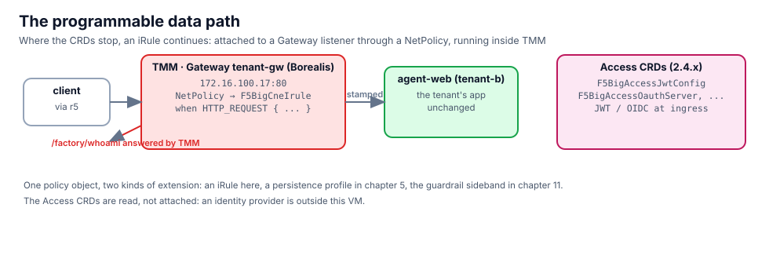

## An iRule, and where it runs

An `F5BigCneIrule` is Tcl that TMM runs on the listener's events. This one answers `/factory/whoami` without
involving any pod and stamps every other request with the tenant:

```bash,run
sed -n '/kind: F5BigCneIrule/,/^---/p' $LAB_ROOT/manifests/chapters/06-stamp-irule.yaml
```

The NetPolicy from chapter 5 already targets Aurora's MCP gateway. A listener takes one NetPolicy, and a NetPolicy
takes several extensions, so the iRule joins the persistence profile in the same object:

```bash,run
kubectl apply -f $LAB_ROOT/manifests/chapters/06-stamp-irule.yaml
sleep 8
kubectl -n tenant-a get f5bigcneirule tenant-stamp -o custom-columns='NAME:.metadata.name,READY:.status.conditions[-1].status,MESSAGE:.status.conditions[-1].message'
kubectl -n tenant-a get netpolicy tenant-mcp-sessions -o jsonpath='{range .spec.extensionRefs[*]}{.kind}/{.name}{"\n"}{end}'
```

From the client, the path TMM answers itself, with the header the iRule sets:

```bash,run
docker exec client curl -s -m 5 -i http://172.16.100.23/factory/whoami | grep -E '^HTTP|^X-Factory|^\{'
```

And the MCP route still works underneath it (the stamp is on the request the pod receives):

```bash,run
docker exec client curl -s -m 10 -D - -o /dev/null http://172.16.100.23/mcp -H 'Content-Type: application/json' -H 'Accept: application/json, text/event-stream' \
  -d '{"jsonrpc":"2.0","id":1,"method":"initialize","params":{"protocolVersion":"2025-03-26","capabilities":{},"clientInfo":{"name":"lab","version":"1"}}}' | grep -iE '^HTTP|^Mcp-Session'
```

## Change it live

Edit the message and re-apply. TMM picks the new iRule up without a restart and without a gap for the sessions
on the listener:

```bash,run
sed 's/before any pod/before any pod, revision 2/' $LAB_ROOT/manifests/chapters/06-stamp-irule.yaml | kubectl apply -f -
sleep 8; docker exec client curl -s -m 5 http://172.16.100.23/factory/whoami; echo
```

## The Access CRDs

BNK 2.4 ships a set of CRDs for identity at ingress. They are the reason the release notes call MCP and A2A
delivery "with OIDC and JWT validation": a `F5BigAccessJwtConfig` describes the issuer, keys and claims a token must
carry; an access profile ties it to a listener; the Gateway rejects a request whose token does not validate before
any pod sees it.

```bash,run
kubectl api-resources | grep f5-big-access | awk '{print $1}' | column -c 120
kubectl explain f5-big-access-jwt-configs.spec | sed -n '1,45p'
```

There is no identity provider inside this VM, so the chapter stops at reading the schema. When Aurora's clients
carry tokens, the attachment is the same `NetPolicy` shape you used twice already.

## What you saw

- One listener, one NetPolicy, two extensions: a protocol-aware profile and your own Tcl.
- An iRule change is a `kubectl apply`, picked up by TMM in seconds.
- Identity checks have a home at the traffic layer; the CRDs are there, the IdP is the only thing missing here.
