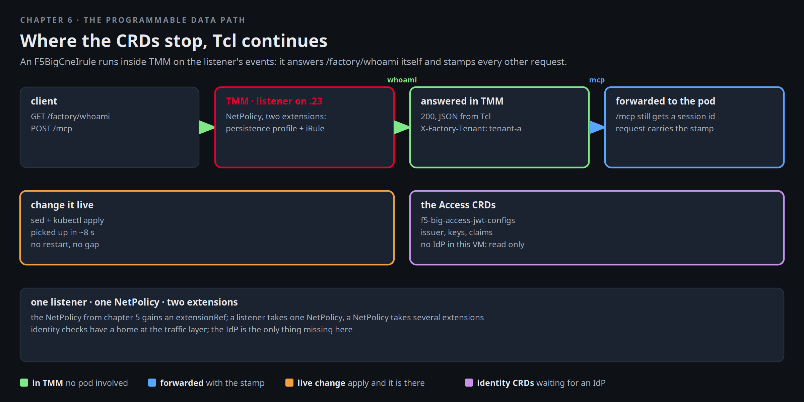

# The programmable data path

Aurora's MCP gateway is live and sticky, and now their security team asks for two small things the CRDs do not
spell: a health answer at `/factory/whoami` that does not wake a pod, and a header on every forwarded request that
says which tenant it belongs to, so their server can refuse anything without it. Mira does not open a ticket with
F5. She writes an iRule. An `F5BigCneIrule` is Tcl that TMM runs on the listener's events, and it attaches to the
listener through the NetPolicy you already have.



[button label="Open the Lab Topology" variant="outline"](tab-2)

The **Lab Topology** tab stays on the MCP flow; the second hop is the listener this chapter programs.

## An iRule, and where it runs

Read the rule first. It is short: on `HTTP_REQUEST`, if the path is `/factory/whoami`, respond with a JSON body and
a header; otherwise insert the header and let the request continue to the pool:

```bash,run
sed -n '/kind: F5BigCneIrule/,/^---/p' $LAB_ROOT/manifests/chapters/06-stamp-irule.yaml
```

`HTTP::respond` is the part that never reaches a pod. `HTTP::header insert` is the stamp. Both run inside TMM on the
listener's events, in the data path, for every request on `172.16.100.23`.

## Attach it

The NetPolicy from chapter 5 already targets Aurora's MCP gateway. A listener takes one NetPolicy, and a NetPolicy
takes several extensions, so the iRule joins the persistence profile in the same object. The manifest's second
document is that NetPolicy with two `extensionRefs`:

```bash,run
sed -n '/kind: NetPolicy/,$p' $LAB_ROOT/manifests/chapters/06-stamp-irule.yaml
kubectl apply -f $LAB_ROOT/manifests/chapters/06-stamp-irule.yaml
sleep 8
kubectl -n tenant-a get f5bigcneirule tenant-stamp -o custom-columns='NAME:.metadata.name,READY:.status.conditions[-1].status,MESSAGE:.status.conditions[-1].message'
kubectl -n tenant-a get netpolicy tenant-mcp-sessions -o jsonpath='{range .spec.extensionRefs[*]}{.kind}/{.name}{"\n"}{end}'
```

`Ready=True` on the iRule, and two extensions on the NetPolicy. From the client, the path TMM answers itself, with
the header the iRule sets:

```bash,run
docker exec client curl -s -m 5 -i http://172.16.100.23/factory/whoami | grep -E '^HTTP|^X-Factory|^\{'
```

No pod saw that request. Prove it: watch the agent pods' logs in **Terminal 2** while you send a few more.

```
kubectl -n tenant-a logs -l app=agent --all-containers --tail=0 -f
```

```bash,run
for i in 1 2 3; do docker exec client curl -s -m 5 -o /dev/null -w '%{http_code} ' http://172.16.100.23/factory/whoami; done; echo
```

Terminal 2 stays silent. Now the MCP route underneath it, which still works and still returns a session id; the
stamp is on the request the pod receives, not on the response:

```bash,run
docker exec client curl -s -m 10 -D - -o /dev/null http://172.16.100.23/mcp -H 'Content-Type: application/json' -H 'Accept: application/json, text/event-stream' \
  -d '{"jsonrpc":"2.0","id":1,"method":"initialize","params":{"protocolVersion":"2025-03-26","capabilities":{},"clientInfo":{"name":"lab","version":"1"}}}' | grep -iE '^HTTP|^Mcp-Session'
```

This time Terminal 2 shows the pod handling the initialize. One listener, two behaviours, selected by path in Tcl.

## Change it live

Aurora asks for the message to say which revision of the rule answered. Edit and re-apply. TMM picks the new rule up
without a restart and without a gap for the sessions on the listener:

```bash,run
sed 's/before any pod/before any pod, revision 2/' $LAB_ROOT/manifests/chapters/06-stamp-irule.yaml | kubectl apply -f -
sleep 8; docker exec client curl -s -m 5 http://172.16.100.23/factory/whoami; echo
kubectl -n tenant-a get f5bigcneirule tenant-stamp -o jsonpath='{.metadata.generation} {.status.conditions[-1].status}{"\n"}'
```

The generation went up by one, the condition is still `True`, and the body changed. Put the original back the same
way:

```bash,run
kubectl apply -f $LAB_ROOT/manifests/chapters/06-stamp-irule.yaml >/dev/null
sleep 8; docker exec client curl -s -m 5 http://172.16.100.23/factory/whoami; echo
```

## Where TMM keeps it

BNK's controller turns the CRD into TMM configuration. The iRule is visible from TMM's side as part of the virtual
server's configuration, which the controller logs when it programs it:

```bash,run
kubectl -n f5-bnk logs deploy/f5-cne-controller --since=10m 2>/dev/null | grep -iE 'irule|tenant-stamp' | tail -5
kubectl -n tenant-a get netpolicy tenant-mcp-sessions -o jsonpath='{range .status.conditions[*]}{.type}={.status} {.message}{"\n"}{end}'
```

## The Access CRDs

BNK 2.4 ships a set of CRDs for identity at ingress, and they are why the release notes describe MCP and A2A delivery
"with OIDC and JWT validation". A `F5BigAccessJwtConfig` describes the issuer, keys and claims a token must carry; an
access profile ties it to a listener; the Gateway rejects a request whose token does not validate before any pod
sees it. The attachment is the same NetPolicy shape you used twice today:

```bash,run
kubectl api-resources | grep f5-big-access | awk '{print $1}' | column -c 120
kubectl explain f5-big-access-jwt-configs.spec | sed -n '1,45p'
```

There is no identity provider inside this VM, so the chapter stops at the schema. When Aurora's clients carry
tokens, this is where they are checked, next to the iRule and the persistence profile.

## What Mira has now

- One listener, one NetPolicy, two extensions: a protocol-aware profile and her own Tcl.
- An iRule change is a `kubectl apply`, picked up by TMM in seconds, with the sessions intact.
- Identity checks have a home at the traffic layer; the CRDs are there, the IdP is the only thing missing here.

## Checkpoint

The check expects the iRule `tenant-stamp` Ready, listed in the NetPolicy's extensionRefs, and `/factory/whoami`
answering with `X-Factory-Tenant: tenant-a`.
