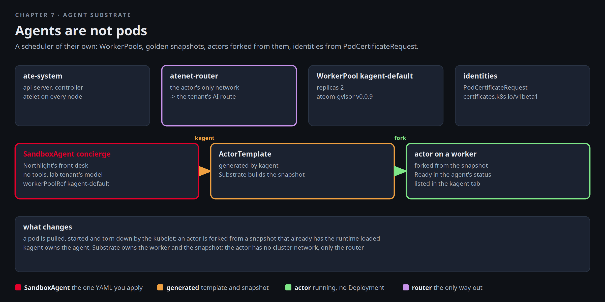

# Agent Substrate

Northlight wants a front desk: an agent any customer can ask "what do I get here?", cheap enough to run many of,
and locked away from the cluster network. The kagent team has a shape for that which is not a Deployment. Agent
Substrate gives agents a scheduler of their own: worker pools, a golden snapshot with the runtime already loaded,
actors forked from it in a moment, and a router that is the only network an actor has. kagent declares a
`SandboxAgent`, and Substrate runs it as an actor.



[button label="Open the Lab Topology" variant="outline"](tab-2)

In the **Lab Topology** tab the Substrate box sits under kagent. The model path for an actor is the **An agent calls
its model** flow, entered through the router instead of the pod network.

## The pieces

Substrate's control plane lives in `ate-system`. Every node runs an `atelet`. The API server, the controller and the
router run as deployments, with a Valkey cluster for state. Clients prove who they are with a Kubernetes
ServiceAccount token minted for one audience, the API server's own name, and the API server checks it against the
cluster's issuer. That is the chart's JWT mode, and it is the only mode kagent's controller speaks:

```bash,run
kubectl -n ate-system get pods -o wide --no-headers | awk '{printf "%-36s %-10s %s\n", $1, $3, $7}'
kubectl api-resources --api-group=ate.dev
helm -n ate-system get values substrate | grep -E 'issuer|mode' | sed 's/^/  chart value: /'
kubectl -n kagent get deploy kagent-controller -o jsonpath='{range .spec.template.spec.volumes[*]}{.name} {.projected.sources[0].serviceAccountToken.audience}{"\n"}{end}' | grep -i ate | sed 's/^/  controller token: /'
```

Three kinds under `ate.dev`. The one you declare against is `WorkerPool`. The one Substrate generates is
`ActorTemplate`. The one the kagent chart created, and the workers it runs:

```bash,run
kubectl -n kagent get workerpools.ate.dev -o wide
kubectl -n kagent get workerpools.ate.dev kagent-default -o jsonpath='{.spec}' | python3 -m json.tool | head -30
kubectl -n kagent get pods -l ate.dev/worker-pool=kagent-default -o wide --no-headers 2>/dev/null || kubectl -n kagent get pods --no-headers | grep -iE 'worker|pool'
```

Two workers on `ateom-gvisor`, which is the isolation layer each actor runs under. Keep **Terminal 2** on
`ate-system` for the rest of the chapter. You will see the controller react to what you apply:

```
kubectl -n ate-system logs -f --tail=5 $(kubectl -n ate-system get deploy -o name | grep -i controller | head -1)
```

## The declaration

A `SandboxAgent` is a kagent agent with a `substrate` block. This one is Northlight's front desk: no tools, the lab
tenant's model, a WorkerPool reference. Read it before applying it:

```bash,run
cat $LAB_ROOT/manifests/chapters/07-concierge-sandboxagent.yaml
kubectl apply -f $LAB_ROOT/manifests/chapters/07-concierge-sandboxagent.yaml
```

kagent turns it into an `ActorTemplate`, Substrate builds the golden snapshot once (that is the slow part, a minute
or two the first time), and the actor starts from it. Watch both arrive:

```bash,run
for i in $(seq 1 24); do
  t=$(kubectl -n kagent get actortemplates.ate.dev --no-headers 2>/dev/null | grep -c concierge)
  r=$(kubectl -n kagent get sandboxagent concierge -o jsonpath='{.status.conditions[?(@.type=="Ready")].status}' 2>/dev/null)
  echo "$(date +%T)  actortemplates: $t   SandboxAgent Ready: ${r:-unknown}"; [ "$r" = True ] && break; sleep 10
done
kubectl -n kagent get actortemplates.ate.dev -o wide 2>/dev/null
kubectl -n kagent get sandboxagent concierge -o jsonpath='{range .status.conditions[*]}{.type}={.status} {.message}{"\n"}{end}'
```

Terminal 2 shows the controller picking up the template and placing the actor on one of the two workers. No
Deployment, no ReplicaSet, no pod of its own:

```bash,run
kubectl -n kagent get deploy,rs --no-headers | grep -c concierge | sed 's/^/Deployments or ReplicaSets named concierge: /'
kubectl -n kagent get actortemplates.ate.dev -o jsonpath='{range .items[*]}{.metadata.name}: {.status}{"\n"}{end}' 2>/dev/null | head -5
```

## Talk to it

Open the **kagent** tab: `concierge` is listed next to `factory-operator`. Ask it what a tenant gets at Northlight.
The answer comes from a worker, through the AI Gateway's lab tenant.

[button label="Open kagent" variant="success"](tab-3)

From the terminal, the same question through A2A on the agents gateway. Two details differ from the tenant
assistants. A sandbox agent has no Service of its own, so kagent serves it under `/api/a2a-sandboxes/` instead of
`/api/a2a/`, and the agents gateway's route claims exactly that one path for the concierge and nothing else in the
kagent namespace. And the message carries a `contextId`, because one session is one actor. Without it kagent has no
actor to send the message to and says so:

```bash,run
kubectl -n kagent get httproute kagent -o jsonpath='{range .spec.rules[0].matches[*]}{.path.value}{"\n"}{end}' | sed 's/^/  route claims: /'
docker exec client curl -s -m 180 http://172.16.100.14/api/a2a-sandboxes/kagent/concierge/ -H 'Content-Type: application/json' -d '{
  "jsonrpc":"2.0","id":1,"method":"message/send","params":{"message":{"role":"user","messageId":"m1","contextId":"front-desk-1",
  "parts":[{"kind":"text","text":"What does a tenant get at Northlight?"}]}}}' | python3 -c 'import json,sys; d=json.load(sys.stdin); r=d.get("result",d); print(json.dumps(r, indent=1)[:1200])'
```

The operator's own agent, `kagent/factory-operator`, is not on that list, so from the client it does not exist.

## Where the model call went

The actor has no cluster network. Its model calls go through Substrate's router, which is the only thing it can
reach, and the router talks to the AI Gateway route of the lab tenant. Polaris records the call under that tenant:

```bash,run
kubectl -n ate-system get svc api atenet-router
kubectl -n ate-system logs --since=5m $(kubectl -n ate-system get deploy -o name | grep -i router | head -1) 2>/dev/null | grep -iE 'chat/completions|172.16.100' | tail -3
kubectl -n kagent get sandboxagent concierge -o jsonpath='{.spec.declarative.modelConfig}{"\n"}'
```

## What it changes

- A pod is scheduled, pulled, started and torn down by the kubelet. An actor is forked from a snapshot that already
  has the runtime loaded, so a second one costs almost nothing. Apply the same file under another name and watch how
  fast the second actor is Ready.
- The actor does not have the cluster network. Its model calls go through the router, which is the only thing it can
  reach, and the router talks to the AI Gateway route of its tenant.
- kagent owns the agent, Substrate owns the worker and the snapshot. Neither has to know the other's images.

## Checkpoint

The check expects Substrate installed in `ate-system`, the WorkerPool `kagent-default`, the SandboxAgent
`concierge`, and at least one ActorTemplate generated for it.
