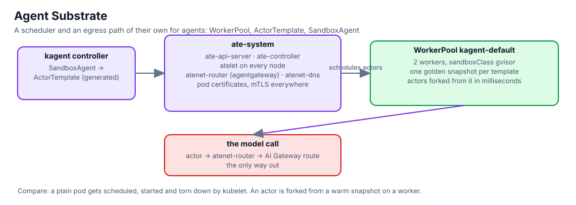

## The pieces

Substrate's control plane lives in `ate-system`. Every node runs an `atelet`; the API server, the controller and
the router (an agentgateway) run as deployments; every pod identity is a certificate issued through Kubernetes'
PodCertificateRequest API, which this cluster has switched on.

```bash,run
kubectl -n ate-system get pods -o wide --no-headers | awk '{printf "%-36s %-10s %s\n", $1, $3, $7}'
kubectl get podcertificaterequests -A --no-headers | wc -l | sed 's/^/pod certificates issued: /'
kubectl api-resources --api-group=ate.dev
```

The WorkerPool the kagent chart created, and the workers it runs:

```bash,run
kubectl -n kagent get workerpools.ate.dev -o wide
kubectl -n kagent get workerpools.ate.dev kagent-default -o jsonpath='{.spec}' | python3 -m json.tool | head -30
kubectl -n kagent get pods -l ate.dev/worker-pool=kagent-default -o wide --no-headers 2>/dev/null || kubectl -n kagent get pods --no-headers | grep -iE 'worker|pool'
```

## Put an agent on it

A `SandboxAgent` is a kagent agent with a `substrate` block. This one is Northlight's front desk: no tools, the lab
tenant's model, a WorkerPool reference.

```bash,run
cat $LAB_ROOT/manifests/chapters/07-concierge-sandboxagent.yaml
kubectl apply -f $LAB_ROOT/manifests/chapters/07-concierge-sandboxagent.yaml
```

kagent turns it into an ActorTemplate, Substrate builds the golden snapshot once, and the actor starts from it:

```bash,run
for i in $(seq 1 24); do
  t=$(kubectl -n kagent get actortemplates.ate.dev --no-headers 2>/dev/null | grep -c concierge)
  r=$(kubectl -n kagent get sandboxagent concierge -o jsonpath='{.status.conditions[?(@.type=="Ready")].status}' 2>/dev/null)
  echo "actortemplates: $t   SandboxAgent Ready: ${r:-unknown}"; [ "$r" = True ] && break; sleep 10
done
kubectl -n kagent get actortemplates.ate.dev -o wide 2>/dev/null
kubectl -n kagent get sandboxagent concierge -o jsonpath='{range .status.conditions[*]}{.type}={.status} {.message}{"\n"}{end}'
```

Open the **kagent** tab: `concierge` is listed next to `factory-operator`, and a question to it is answered from a
worker, through the AI Gateway's lab tenant. From the terminal, the same through A2A on the agents gateway:

```bash,run
docker exec client curl -s -m 120 http://172.16.100.14/api/a2a/kagent/concierge/ -H 'Content-Type: application/json' -d '{
  "jsonrpc":"2.0","id":1,"method":"message/send","params":{"message":{"role":"user","messageId":"m1",
  "parts":[{"kind":"text","text":"What does a tenant get at Northlight?"}]}}}' | python3 -c 'import json,sys; d=json.load(sys.stdin); r=d.get("result",d); print(json.dumps(r, indent=1)[:900])'
```

(The agents gateway publishes only the tenant assistants' paths; if the call above is refused, that is the policy
from chapter 5 doing its job. Use the kagent tab for the front desk.)

## What it changes

- A pod is scheduled, pulled, started and torn down by the kubelet. An actor is forked from a snapshot that already
  has the runtime loaded; a second one costs almost nothing.
- The actor does not have the cluster network. Its model calls go through Substrate's router, which is the only
  thing it can reach, and the router talks to the AI Gateway route of its tenant.
- kagent owns the agent, Substrate owns the worker and the snapshot. Neither has to know the other's images.

## What you saw

Substrate's components and their certificates, the WorkerPool with its workers, and one SandboxAgent going from a
YAML file to a running actor without a Deployment in between.
