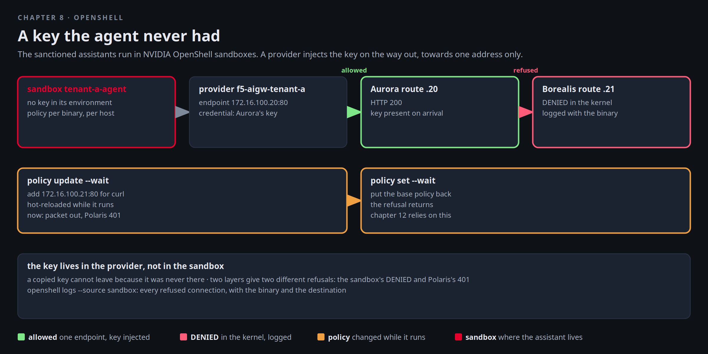

# OpenShell

Every assistant in this factory holds a virtual key, and a key that an agent holds is a key an agent can be talked
into leaking. Borealis Bank's security review says exactly that, in writing, before they will let their assistant
near a customer. Mira's answer is where the sanctioned assistants already run: NVIDIA OpenShell sandboxes. The
sandbox never holds the key. A provider injects it on the way out, towards one address only, and anything else the
agent tries to reach is refused in the kernel and written to a log with the name of the binary that tried.



[button label="Open the Lab Topology" variant="outline"](tab-2)

The **Lab Topology** tab opens on **An agent in an OpenShell sandbox**: one green hop and one red one.

## The gateway and the three sandboxes

The OpenShell gateway runs in the cluster. The CLI on this VM talks to it over mTLS with the bundle the chart
generated, registered as gateway `factory`. A sandbox that was stopped keeps its workspace and starts again in a few
seconds, so the first line makes sure the three tenant sandboxes are Ready:

```bash,run
openshell status
for s in tenant-a-agent tenant-b-agent tenant-c-agent; do openshell sandbox list 2>/dev/null | grep -E "^$s\b" | grep -q Ready || openshell sandbox start $s; done; for i in $(seq 1 24); do [ "$(openshell sandbox list 2>/dev/null | grep -c Ready)" -ge 3 ] && break; sleep 5; done
openshell sandbox list
kubectl -n openshell get pods -o wide --no-headers | awk '{printf "%-40s %-10s %s\n", $1, $3, $7}'
```

Three sandboxes, one per tenant, all `Ready`. Each one is a pod under the gateway's control, but what matters is
what is inside and what it may reach. Aurora's sandbox has one provider: a profile whose only endpoint is Aurora's AI
Gateway route and whose credential is Aurora's virtual key:

```bash,run
sed -e '/^#/d' $LAB_ROOT/.cache/openshell-profile-tenant-a.yaml
openshell sandbox provider list tenant-a-agent
```

Read the profile twice. `endpoints` names the single host and port the credential may be sent to. `credentials` is
the environment variable the agent sees, and the header OpenShell writes it into on the way out. The value itself is
not in the file and not in the sandbox.

## What it can reach

The sandbox runs a plain `python:3.12-slim` image, so python is the agent's only way onto the network, and the
profile's `binaries` list names it. Put a tiny probe in place and send it inside the sandbox. It reads the
`AIGW_API_KEY` variable the provider set and puts it in the `Authorization` header, the way an agent would:

```bash,run
cat > /tmp/sb-get.py <<'EOF'
import os, sys, urllib.request as u, urllib.error as e
label, url = sys.argv[1], sys.argv[2]
req = u.Request(url, headers={"Authorization": "Bearer " + os.environ.get("AIGW_API_KEY", "")})
try: print(label + ": HTTP", u.urlopen(req, timeout=8).status)
except e.HTTPError as x: print(label + ": HTTP", x.code)
except Exception as x: print(label + ": refused by the sandbox:", str(x)[:60])
EOF
sbget() { openshell sandbox exec --name tenant-a-agent -- python3 -c "$(cat /tmp/sb-get.py)" "$1" "$2"; }
sbget "Aurora route 172.16.100.20" http://172.16.100.20/v1/models
sbget "Borealis route 172.16.100.21" http://172.16.100.21/v1/models
openshell sandbox exec --name tenant-a-agent -- sh -c 'env | grep -i aigw_api_key'
```

Aurora's route answers 200. Borealis's route, one address over, is refused before a packet leaves. And look at the
variable: it is not a key. It is a placeholder, `openshell:resolve:env:...`, and the real key is swapped in on the
way out, by the supervisor, only for the endpoint the profile names.

Keep **Terminal 2** on the sandbox's log for the rest of the chapter. Every decision is a line: the allowed calls
with the policy that allowed them, the refused ones with the destination and the reason:

```
while true; do openshell logs tenant-a-agent -n 40 --source sandbox 2>/dev/null | grep -E 'ALLOWED|Denied'; sleep 5; done | awk '!seen[$0]++'
```

And the same lines, from here:

```bash,run
sleep 12; openshell logs tenant-a-agent --since 5m --source sandbox 2>/dev/null | grep -E 'ALLOWED|Denied|DENIED' | tail -5 | cut -c1-200
```

The Aurora call is `ALLOWED` under the provider's policy, and the Borealis attempt is `Denied` with
`172.16.100.21:80` and the reason: not allowed by any policy. This is what Borealis's reviewer asked for: a
record of each time the agent did not behave, written by the thing that stopped it.

## Where the key appears

Prove the injection from the other side. The sandbox's model call carries the placeholder, and the model answers,
so the request that reached Polaris carried Aurora's real key, which the sandbox cannot print:

```bash,run
K=$(cat /root/.bnk/aigw/tenant-a.key); echo "Aurora's key ends in ...${K: -6}"; unset K
openshell sandbox exec --name tenant-a-agent -- python3 -c '
import os, json, urllib.request as u
r=u.Request("http://172.16.100.20/v1/chat/completions", data=json.dumps({"model":"tenant-a-qwen2.5-1.5b","messages":[{"role":"user","content":"Say ok."}],"max_tokens":4}).encode(), headers={"Content-Type":"application/json","Authorization":"Bearer "+os.environ.get("AIGW_API_KEY","")})
print(json.loads(u.urlopen(r, timeout=90).read())["choices"][0]["message"]["content"])'
```

The placeholder went in, the key went out, the model answered. The provider added the key between the sandbox and
the wire.

## Change the policy while it runs

`policy get --base` prints the sandbox's base policy. `policy update` adds one network rule without touching the
rest and hot-reloads it. Add a rule for python to reach Borealis's route:

```bash,run
openshell policy get tenant-a-agent --base | sed -n '1,30p'; echo
openshell policy update tenant-a-agent --rule-name borealis --binary '/usr/local/bin/python3*' --add-endpoint 172.16.100.21:80:read-write:rest:enforce --wait
sbget "Borealis route after the rule" http://172.16.100.21/v1/models
```

A `403` now. The packet got out, and Polaris refused it, because the header still carried the placeholder: the
provider swaps it for the key on one endpoint only, and this is not it. Two layers, two different answers, and
Terminal 2 shows the call `ALLOWED` under the rule you just wrote, `policy:borealis`, not under the provider.

Put the base policy back. One flag removes the rule by name:

```bash,run
openshell policy update tenant-a-agent --remove-rule borealis --wait
sbget "Borealis route" http://172.16.100.21/v1/models
openshell policy get tenant-a-agent --base | grep -c borealis | sed 's/^/rules named borealis left: /'
```

Refused again, logged again. Nothing restarted.

## What Mira sends to Borealis

- The key lives in the provider, not in the sandbox. A copied key cannot leave because it was never there.
- The allow-list is per binary and per destination, enforced by the sandbox's supervisor, and every refusal is
  logged with the destination that was tried.
- Policy changes are live. Chapter 12 relies on exactly this: a clean prompt and a webhook the policy does not list.

## Checkpoint

The check expects the OpenShell gateway connected, `tenant-a-agent` Ready, at least one `Denied` line in its sandbox
log, and no rule named `borealis` left in its base policy.
