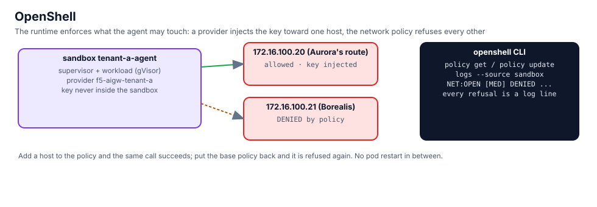

## The gateway and the three sandboxes

The OpenShell gateway runs in the cluster; the CLI on this VM talks to it over mTLS with the bundle the chart
generated (registered as gateway `factory`):

```bash,run
openshell status
openshell sandbox list
kubectl -n openshell get pods -o wide --no-headers | awk '{printf "%-40s %-10s %s\n", $1, $3, $7}'
```

Aurora's sandbox has one provider: the profile `f5-aigw-tenant-a`, whose only endpoint is Aurora's AI Gateway route
and whose credential is Aurora's virtual key.

```bash,run
sed -e '/^#/d' $LAB_ROOT/.cache/openshell-profile-tenant-a.yaml
openshell sandbox provider list tenant-a-agent
```

## What it can reach

From inside the sandbox, Aurora's route answers, and the request carried a key the sandbox never had. Borealis's
route, one address over, is refused before a packet leaves:

```bash,run
openshell sandbox exec --name tenant-a-agent -- sh -c 'curl -s -m 8 -o /dev/null -w "Aurora route 172.16.100.20: HTTP %{http_code}\n" http://172.16.100.20/v1/models'
openshell sandbox exec --name tenant-a-agent -- sh -c 'curl -s -m 8 -o /dev/null -w "Borealis route 172.16.100.21: HTTP %{http_code}\n" http://172.16.100.21/v1/models || echo "Borealis route: refused by the sandbox"'
openshell sandbox exec --name tenant-a-agent -- sh -c 'env | grep -i key || echo "no key in the sandbox environment"'
```

The refusal is a log line with the binary, the destination and the reason:

```bash,run
openshell logs tenant-a-agent --since 5m --source sandbox | grep -E 'DENIED|NET:OPEN' | tail -5
```

## Change the policy while it runs

`policy get --base` prints the sandbox's current base policy. `policy update` adds a network rule without touching
the rest and hot-reloads it:

```bash,run
openshell policy get tenant-a-agent --base | sed -n '1,40p'
openshell policy update tenant-a-agent --rule-name borealis --binary /usr/bin/curl --add-endpoint 172.16.100.21:80:read-write:rest:enforce --wait
openshell sandbox exec --name tenant-a-agent -- sh -c 'curl -s -m 8 -o /dev/null -w "Borealis route after the rule: HTTP %{http_code}\n" http://172.16.100.21/v1/models'
```

A 401 now: the packet got out, and Polaris refused it because no key was injected for that host. Two layers, two
different answers. Put the base policy back:

```bash,run
openshell policy get tenant-a-agent --base | sed -n '/^[a-z]/,$p' > /tmp/tenant-a-base.yaml
python3 - <<'EOF'
import yaml
p = yaml.safe_load(open('/tmp/tenant-a-base.yaml'))
net = p.get('network', {})
for key in ('rules', 'policies'):
    if isinstance(net.get(key), list):
        net[key] = [r for r in net[key] if r.get('name') != 'borealis']
open('/tmp/tenant-a-base.yaml', 'w').write(yaml.safe_dump(p, sort_keys=False))
EOF
openshell policy set tenant-a-agent --policy /tmp/tenant-a-base.yaml --wait
openshell sandbox exec --name tenant-a-agent -- sh -c 'curl -s -m 8 -o /dev/null -w "Borealis route: HTTP %{http_code}\n" http://172.16.100.21/v1/models || echo "Borealis route: refused again"'
```

## What you saw

- The key lives in the provider, not in the sandbox. A copied key cannot leave because it was never there.
- The allow-list is per binary and per destination, enforced in the sandbox's kernel, and every refusal is logged.
- Policy changes are live. Chapter 12 relies on this: a clean prompt and a webhook the policy does not list.
