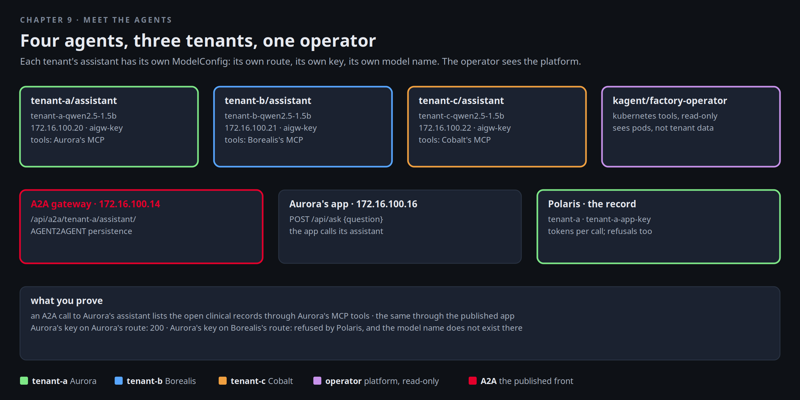

# Meet the agents

Thursday is the demo. Each customer gets to ask their own assistant a question about their own data, and Mira has
to be able to say, for every answer, which key made the call, which model answered, and that the other two tenants
could not have seen any of it. There are four agents in the factory: one assistant per tenant, each in the tenant's
namespace with the tenant's own model name, route and key, and Northlight's operator agent, which sees the platform
and nothing of the tenants' data.



[button label="Open the Lab Topology" variant="outline"](tab-2)

The **Lab Topology** tab opens on **An agent calls its model**: pod to TMM's internal leg, the Polaris checks, the
model.

## Who is who

Four kagent agents. The tenant assistants carry MCP tools from their own sidecar. `factory-operator` carries
read-only Kubernetes tools:

```bash,run
kubectl get agents.kagent.dev -A
kubectl -n tenant-a get agent assistant -o jsonpath='{.spec.declarative.tools[*].mcpServer.toolNames}{"\n"}'
kubectl -n kagent get agent factory-operator -o jsonpath='{.spec.declarative.tools[*].mcpServer.name}{"\n"}'
kubectl -n tenant-a get agent assistant -o jsonpath='{.spec.declarative.systemMessage}{"\n"}' | head -8
```

Each tenant's model access is a `ModelConfig` pointing at the tenant's own route with the tenant's own key. The model
name is prefixed with the tenant, because model names are cluster-wide in Polaris and Aurora's model must not be
addressable from Borealis's route:

```bash,run
for t in a b c; do kubectl -n tenant-$t get modelconfig tenant-model -o jsonpath='tenant-'$t': {.spec.model} via {.spec.openAI.baseUrl} key Secret/{.spec.apiKeySecret}{"\n"}'; done
kubectl -n tenant-a get pods -o wide --no-headers | awk '{printf "%-36s %-10s %s\n", $1, $3, $7}'
```

Where the assistants are published: one BNK Gateway on `172.16.100.14` in BNK's namespace, with kagent's HTTPRoute
attached to it and only the tenant paths in it. That is the surface the client sees:

```bash,run
kubectl -n f5-bnk get gateway/agents-gw; kubectl -n kagent get httproute
kubectl -n kagent get httproute kagent -o jsonpath='{range .spec.rules[0].matches[*]}{.path.value}{"\n"}{end}'
```

## Ask Aurora's assistant

Through A2A on the agents gateway, with the persistence profile from chapter 5 underneath. A CPU model takes up to
a minute, so open the **Polaris** tab while it runs and watch the call arrive under tenant `tenant-a`:

[button label="Open Polaris" variant="success"](tab-4)

```bash,run
docker exec client curl -s -m 180 http://172.16.100.14/api/a2a/tenant-a/assistant/ -H 'Content-Type: application/json' -d '{
  "jsonrpc":"2.0","id":1,"method":"message/send","params":{"message":{"role":"user","messageId":"m1",
  "parts":[{"kind":"text","text":"Which clinical queue records are still open? One line per record."}]}}}' \
  | python3 -c 'import json,sys; d=json.load(sys.stdin); r=d.get("result",{}); parts=[p.get("text","") for a in r.get("artifacts",[]) for p in a.get("parts",[])] or [p.get("text","") for p in r.get("status",{}).get("message",{}).get("parts",[])]; print("\n".join(parts) or json.dumps(d)[:600])'
```

The answer lists records the assistant read through Aurora's MCP tools. In Polaris the call is under `tenant-a`, key
`tenant-a-app-key`, model `tenant-a-qwen2.5-1.5b`, with prompt and completion token counts. Watch the assistant work
from the inside in **Terminal 2** while you ask again:

```
kubectl -n tenant-a logs deploy/assistant -f --tail=5
```

Through the tenant's own published app, which is how Aurora's users will reach it. A BNK Gateway `tenant-gw` in
tenant-a on `172.16.100.16` carries an L4Route to a small web app that calls the assistant:

```bash,run
kubectl -n tenant-a get gateway tenant-gw; kubectl -n tenant-a get l4routes.gateway.k8s.f5.com
docker exec client curl -s -m 180 http://172.16.100.16/api/ask -H 'Content-Type: application/json' -d '{"question":"Where do I run, and how does my traffic leave the factory?"}' | python3 -c 'import json,sys; d=json.load(sys.stdin); print(d.get("answer", d))'
```

## A key stops at its tenant

This is the sentence Mira needs for the demo. Aurora's key on Aurora's route works. The same key on Borealis's route
is refused by Polaris, and the model name Aurora uses does not exist for Borealis anyway:

```bash,run
K=$(cat /root/.bnk/aigw/tenant-a.key)
docker exec client curl -s -m 60 http://172.16.100.20/v1/chat/completions -H "Authorization: Bearer $K" -H 'Content-Type: application/json' \
  -d '{"model":"tenant-a-qwen2.5-1.5b","messages":[{"role":"user","content":"Say ok."}],"max_tokens":5}' | python3 -c 'import json,sys; d=json.load(sys.stdin); print("Aurora route:", d.get("choices",[{}])[0].get("message",{}).get("content") or d.get("error"))'
docker exec client curl -s -m 20 http://172.16.100.21/v1/chat/completions -H "Authorization: Bearer $K" -H 'Content-Type: application/json' \
  -d '{"model":"tenant-b-qwen2.5-1.5b","messages":[{"role":"user","content":"Say ok."}],"max_tokens":5}' | python3 -c 'import json,sys; d=json.load(sys.stdin); print("Borealis route with Aurora key:", d.get("error",{}).get("message") or d)'
docker exec client curl -s -m 20 http://172.16.100.20/v1/chat/completions -H "Authorization: Bearer $K" -H 'Content-Type: application/json' \
  -d '{"model":"tenant-b-qwen2.5-1.5b","messages":[{"role":"user","content":"Say ok."}],"max_tokens":5}' | python3 -c 'import json,sys; d=json.load(sys.stdin); print("Aurora route asking for Borealis model:", d.get("error",{}).get("message") or d)'
unset K
```

Three lines: a 200, a refusal by key, a refusal by model. Polaris has all three, under the tenant whose route was
called. The same holds for Borealis's and Cobalt's assistants. Ask one if you want the symmetric proof:

```bash,run
docker exec client curl -s -m 180 http://172.16.100.14/api/a2a/tenant-c/assistant/ -H 'Content-Type: application/json' -d '{
  "jsonrpc":"2.0","id":1,"method":"message/send","params":{"message":{"role":"user","messageId":"m2",
  "parts":[{"kind":"text","text":"What tools do you have, and which tenant are you?"}]}}}' \
  | python3 -c 'import json,sys; d=json.load(sys.stdin); r=d.get("result",{}); parts=[p.get("text","") for a in r.get("artifacts",[]) for p in a.get("parts",[])] or [p.get("text","") for p in r.get("status",{}).get("message",{}).get("parts",[])]; print("\n".join(parts)[:600] or json.dumps(d)[:400])'
```

## The operator

Open the **kagent** tab: the four agents, their tools and a chat with each. The tenant assistants have no Kubernetes
tools. `factory-operator` has them read-only. Ask it "which pods are not Running?" and compare with the terminal:

[button label="Open kagent" variant="success"](tab-3)

```bash,run
kubectl get pods -A --field-selector status.phase!=Running,status.phase!=Succeeded --no-headers | head
kubectl -n kagent get agent factory-operator -o jsonpath='{.spec.declarative.tools[*].mcpServer.toolNames}{"\n"}' | tr ' ' '\n' | head -12
```

Every tool in that list is a read. The operator can tell Mira what is broken. It cannot change anything, and it
cannot read a tenant's records because it has none of their tools.

## What Mira says on Thursday

Tenant assistants are tenant workloads: their keys, models and tools belong to the tenant and stop at its edge. The
operator sees the platform, nothing of the tenants' data. Polaris has a record of every call. Chapter 10 is what
happens when somebody builds an agent from these same parts and nobody reviews it.

## Checkpoint

The check expects the three tenant assistants Ready and Aurora's key refused on Borealis's route with a 401 or 403.
