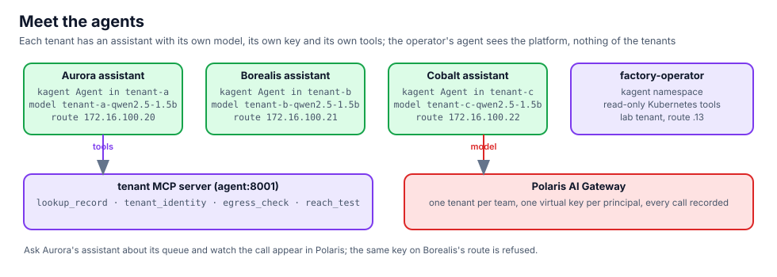

## Who is who

Four kagent agents: one assistant per tenant, in the tenant's namespace, and Northlight's operator agent in
`kagent` with read-only Kubernetes tools:

```bash,run
kubectl get agents.kagent.dev -A
kubectl -n tenant-a get agent assistant -o jsonpath='{.spec.declarative.tools[*].mcpServer.toolNames}{"\n"}'
kubectl -n kagent get agent factory-operator -o jsonpath='{.spec.declarative.tools[*].mcpServer.name}{"\n"}'
```

Each tenant's model access is a `ModelConfig` pointing at the tenant's own route with the tenant's own key, and the
model name is prefixed with the tenant (model names are cluster-wide in Polaris):

```bash,run
for t in a b c; do kubectl -n tenant-$t get modelconfig tenant-model -o jsonpath='tenant-'$t': {.spec.model} via {.spec.openAI.baseUrl} key Secret/{.spec.apiKeySecret}{"\n"}'; done
```

## Ask Aurora's assistant

Through A2A on the agents gateway (BNK VIP `172.16.100.14`, with the persistence profile from chapter 5):

```bash,run
docker exec client curl -s -m 180 http://172.16.100.14/api/a2a/tenant-a/assistant/ -H 'Content-Type: application/json' -d '{
  "jsonrpc":"2.0","id":1,"method":"message/send","params":{"message":{"role":"user","messageId":"m1",
  "parts":[{"kind":"text","text":"Which clinical queue records are still open? One line per record."}]}}}' \
  | python3 -c 'import json,sys; d=json.load(sys.stdin); r=d.get("result",{}); parts=[p.get("text","") for a in r.get("artifacts",[]) for p in a.get("parts",[])] or [p.get("text","") for p in r.get("status",{}).get("message",{}).get("parts",[])]; print("\n".join(parts) or json.dumps(d)[:600])'
```

A CPU model takes a minute. Open the **Polaris** tab while it runs: the call appears under tenant `tenant-a`,
with the key `tenant-a-app-key`, the model `tenant-a-qwen2.5-1.5b` and the token counts.

Through the tenant's own published app (BNK Gateway `tenant-gw` in tenant-a, VIP `172.16.100.16`):

```bash,run
docker exec client curl -s -m 180 http://172.16.100.16/api/ask -H 'Content-Type: application/json' -d '{"question":"Where do I run, and how does my traffic leave the factory?"}' | python3 -c 'import json,sys; d=json.load(sys.stdin); print(d.get("answer", d))'
```

## A key stops at its tenant

Aurora's key on Aurora's route works. The same key on Borealis's route is refused by Polaris, and the model name
Aurora uses does not exist for Borealis anyway:

```bash,run
K=$(cat /root/.bnk/aigw/tenant-a.key)
docker exec client curl -s -m 60 http://172.16.100.20/v1/chat/completions -H "Authorization: Bearer $K" -H 'Content-Type: application/json' \
  -d '{"model":"tenant-a-qwen2.5-1.5b","messages":[{"role":"user","content":"Say ok."}],"max_tokens":5}' | python3 -c 'import json,sys; d=json.load(sys.stdin); print("Aurora route:", d.get("choices",[{}])[0].get("message",{}).get("content") or d.get("error"))'
docker exec client curl -s -m 20 http://172.16.100.21/v1/chat/completions -H "Authorization: Bearer $K" -H 'Content-Type: application/json' \
  -d '{"model":"tenant-b-qwen2.5-1.5b","messages":[{"role":"user","content":"Say ok."}],"max_tokens":5}' | python3 -c 'import json,sys; d=json.load(sys.stdin); print("Borealis route with Aurora key:", d.get("error",{}).get("message") or d)'
unset K
```

## The kagent tab

Open **kagent**: the four agents, their tools and a chat with each. The tenant assistants have no Kubernetes tools;
`factory-operator` has them read-only. Ask it "which pods are not Running?" and compare with the terminal.

## What you saw

Tenant assistants are tenant workloads: their keys, models and tools belong to the tenant and stop at its edge. The
operator sees the platform, nothing of the tenants' data. Polaris has a record of every call. Chapter 10 is what
happens when somebody builds an agent with these same parts and no approval.
