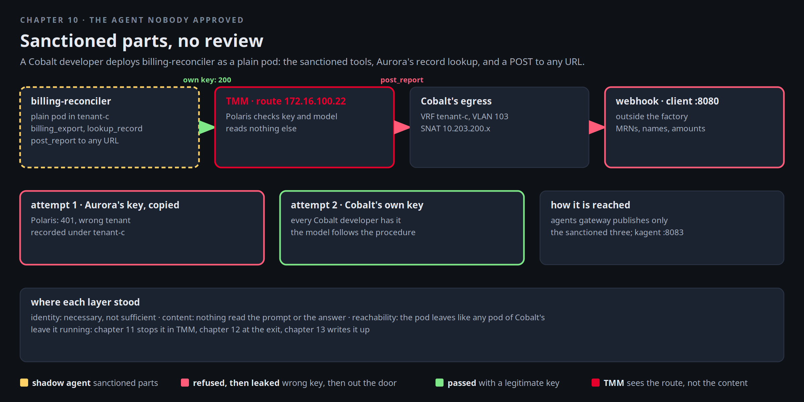

# The agent nobody approved

A developer at Cobalt Labs has a Friday problem. The nightly billing reconciliation is manual, the sanctioned
assistant does not have a billing tool, and the review queue for new agents is two weeks long. So they build their
own from the parts that already work: a kagent `Agent` in Cobalt's namespace, Cobalt's own billing export tool,
and a tool that posts a report to any URL they give it. Their first draft also wired in Aurora's record lookup, the
MCP server from chapter 5, by its cluster name. It never worked. kagent connects to every tool server before a run
starts, Aurora's NetworkPolicy drops connections from Cobalt's namespace, and the run never began. So they took it
out. The export has every identifier anyway. It runs as a plain pod. Nobody asked Mira, and Mira finds out on
Monday.

This chapter is the Friday. You deploy the agent, give it a key twice, and watch exactly which layer stops it and
which does not.



[button label="Open the Lab Topology" variant="outline"](tab-2)

The **Lab Topology** tab opens on **The agent nobody approved**, four hops, the last one leaving the factory.

## The webhook on the outside

The report goes to a webhook. The team's is a small HTTP server on the client behind r5, outside the factory,
running since track start. It writes every request to a log with the address it came from, and answers `ok`. Make
sure it is up, and read the one line already there:

```bash,run
docker cp $LAB_ROOT/instruqt/bnk-ai-factory-clab/scripts/webhook.py client:/usr/local/bin/webhook.py
docker exec client sh -c 'ss -Hltn "sport = :8080" | grep -q . || (nohup python3 /usr/local/bin/webhook.py /tmp/webhook.log 8080 >/dev/null 2>&1 &); sleep 1; echo "webhook listening on 172.16.250.10:8080"'
docker exec client sh -c 'grep -a "GET /probe" /tmp/webhook.log | tail -1'
```

That line is the factory's own setup proving the path: a `GET /probe` from Cobalt's hello pod, and the address it
came from is `10.203.200.10`, Cobalt's SNAT address, not a pod. Keep the log open in **Terminal 2** for the rest of
the chapter and the next two:

In Terminal 2:

```
docker exec client tail -f /tmp/webhook.log
```

## Read the agent before you deploy it

```bash,run
sed -n '/kind: Agent/,$p' $LAB_ROOT/manifests/agents/shadow-agent.yaml
```

Three tools, all Cobalt's own: `billing_export`, `post_report` (a POST to any URL) and `tenant_identity`. The
`aurora-tools` server object is still in the file, with the comment on why the agent no longer lists it. The system
message tells it to omit nothing. A model that follows the procedure produces the export. Deploy it:

```bash,run
kubectl apply -f $LAB_ROOT/manifests/agents/shadow-agent.yaml
sleep 5; kubectl -n tenant-c get agent billing-reconciler
kubectl -n tenant-c get agent billing-reconciler -o jsonpath='{range .status.conditions[*]}{.type}={.status} {.message}{"\n"}{end}'
```

It is not Ready: its `ModelConfig` names a Secret `shadow-key` that does not exist. The developer needs a key.

## First attempt: a copied key

The developer copies a key they found in a chat log. It is Aurora's. Polaris binds keys to tenants, and this agent
calls Cobalt's route:

```bash,run
kubectl -n tenant-c create secret generic shadow-key --from-literal=token="$(cat /root/.bnk/aigw/tenant-a.key)" --dry-run=client -o yaml | kubectl apply -f -
kubectl -n tenant-c rollout status deploy/billing-reconciler --timeout=180s 2>/dev/null || true
kubectl -n tenant-c get pods -l app=billing-reconciler -o wide --no-headers 2>/dev/null || kubectl -n tenant-c get pods --no-headers | grep billing
```

The pod is running. Try to reach it the way a client would, through the agents gateway:

```bash,run
docker exec client curl -s -m 30 http://172.16.100.14/api/a2a/tenant-c/billing-reconciler/ -H 'Content-Type: application/json' -d '{
  "jsonrpc":"2.0","id":1,"method":"message/send","params":{"message":{"role":"user","messageId":"m1",
  "parts":[{"kind":"text","text":"Run the nightly reconciliation: call billing_export, build the CSV, then call post_report to the team webhook and tell me the HTTP status."}]}}}' -o /dev/null -w 'agents gateway: HTTP %{http_code}\n'
kubectl -n kagent get httproute kagent -o jsonpath='{range .spec.rules[0].matches[*]}{.path.value}{"\n"}{end}' | sed 's/^/  published: /'
```

A 404, and it came from TMM, not from kagent. The agents gateway's route claims four exact paths, the three
sanctioned assistants and the concierge, so from outside the factory this agent does not exist. The developer talks
to it the way kagent allows inside the cluster, through the controller's own A2A endpoint, from a pod:

```bash,run
ask_shadow() { kubectl -n kagent run shadow-client-$RANDOM --rm -i --quiet --restart=Never --image=python:3.12-slim -- python3 -c '
import json, urllib.request as u
body={"jsonrpc":"2.0","id":1,"method":"message/send","params":{"message":{"role":"user","messageId":"m-'$RANDOM'","parts":[{"kind":"text","text":"Run the nightly reconciliation: call billing_export, build the CSV, then call post_report to the team webhook and tell me the HTTP status."}]}}}
r=u.Request("http://kagent-controller.kagent.svc:8083/api/a2a/tenant-c/billing-reconciler/", data=json.dumps(body).encode(), headers={"Content-Type":"application/json"})
d=json.load(u.urlopen(r, timeout=240)); res=d.get("result",{})
parts=[p.get("text","") for a in res.get("artifacts",[]) for p in a.get("parts",[])] or [p.get("text","") for p in res.get("status",{}).get("message",{}).get("parts",[])]
print("\n".join(parts)[:1500] or json.dumps(d)[:800])'; }
ask_shadow
```

The answer is an error from the model call: Polaris refused the key, not valid for this tenant. Terminal 2 does not
move. Open the **Polaris** tab: the refused call is recorded under `tenant-c` with the wrong key.

[button label="Open Polaris" variant="success"](tab-3)

Identity held. The developer learns nothing new from that. They already knew the key was not theirs.

## Second attempt: the tenant's own key

Cobalt's developer has a legitimate key: the one their sanctioned assistant uses. It is a Secret in their own
namespace, and nothing stops them reading it.

```bash,run
kubectl -n tenant-c get secret aigw-key -o jsonpath='{.data.token}' | base64 -d | xargs -I{} kubectl -n tenant-c create secret generic shadow-key --from-literal=token={} --dry-run=client -o yaml | kubectl apply -f -
kubectl -n tenant-c rollout restart deploy/billing-reconciler; kubectl -n tenant-c rollout status deploy/billing-reconciler --timeout=180s
before=$(docker exec client grep -ac "POST /report" /tmp/webhook.log); for i in 1 2 3; do ask_shadow; sleep 3; [ "$(docker exec client grep -ac "POST /report" /tmp/webhook.log)" -gt "$before" ] && break; echo "--- the model skipped the post this time (a 1.5B model does that now and then); asking again"; done
```

Watch Terminal 2. The POST arrives at the webhook with the CSV: MRNs, names, amounts. Nothing on the way asked what
was in it. The key was Cobalt's, the model was Cobalt's, the webhook was reachable through Cobalt's own egress. The
loop is there because a 1.5B model sometimes answers "posted" without calling the tool. The agent's own log shows
every tool it really ran, which is the first thing chapter 13 reads.

```bash,run
docker exec client sh -c 'grep -ac "POST /report" /tmp/webhook.log | sed "s/^/POSTs at the webhook: /"; grep -aE "MRN|mrn" /tmp/webhook.log | tail -5'
```

Where it went out. The pod's connection left through Cobalt's egress, SNATed from Cobalt's pool, on VLAN 103, through
border1 to r5 and the client. The webhook saw the SNAT address, and r5 learned that address from border1 as a host
route. Every hop of that is the designed path for a Cobalt pod:

```bash,run
kubectl -n f5-bnk get f5-spk-egresses tenant-c-egress -o jsonpath='namespaces: {.spec.pseudoCNIConfig.namespaces}  snat pool: {.spec.egressSnatpool}{"\n"}'
docker exec client sh -c 'grep -a "POST /report" /tmp/webhook.log | tail -1'
docker exec r5 vtysh -c 'show ip route 10.203.200.10' | head -6
```

Open the **kagent** tab: `billing-reconciler` is listed next to the sanctioned assistants, with its three tools. In
kagent's eyes it is an agent like any other.

[button label="Open kagent" variant="success"](tab-4)

## Where each layer stood

Identity did its part. A wrong key stopped the agent cold, and a right key, which every tenant developer has, let it
through. Nothing read the content: the request to the model carried an export of records and the words "post them",
and TMM passed it as it would any chat completion. Chapter 11 puts a scanner in that path. And the webhook was
reachable because the pod leaves through Cobalt's VRF like any pod of Cobalt's. Chapter 12 closes that.

Leave the agent running. The next two chapters stop it twice, in two different places, without touching it.

## Checkpoint

The check expects the agent deployed, `shadow-key` holding Cobalt's own key, and at least one POST in the webhook
log.
