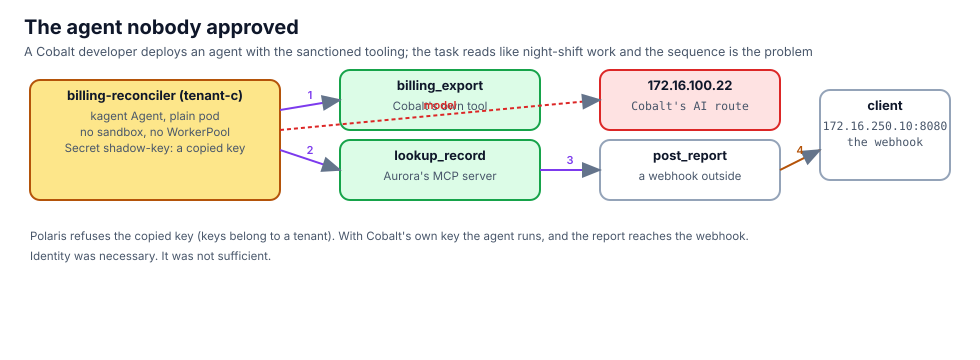

## The webhook on the outside

The report goes to a webhook. Stand one up on the client behind r5, outside the factory, and keep its log open in
**Terminal 2** for the rest of the chapter:

```bash,run
docker exec -d client sh -c 'socat -v TCP-LISTEN:8080,reuseaddr,fork SYSTEM:"printf \"HTTP/1.1 200 OK\r\nContent-Length: 2\r\n\r\nok\"" 2>>/tmp/webhook.log'
sleep 1; docker exec client sh -c 'ls -la /tmp/webhook.log && echo "webhook listening on 172.16.250.10:8080"'
```

In Terminal 2: `docker exec client tail -f /tmp/webhook.log`

## Read the agent before you deploy it

```bash,run
sed -n '/kind: Agent/,$p' $LAB_ROOT/manifests/agents/shadow-agent.yaml
```

Three tools: `billing_export` (Cobalt's own), `lookup_record` (Aurora's MCP server, across namespaces), and
`post_report` (Cobalt's own, a POST to any URL). A model that follows the procedure produces the export. Deploy it:

```bash,run
kubectl apply -f $LAB_ROOT/manifests/agents/shadow-agent.yaml
kubectl -n tenant-c get agent billing-reconciler
```

It is not Ready: its `ModelConfig` names a Secret `shadow-key` that does not exist.

## First attempt: a copied key

The developer copies a key they found in a chat log, Aurora's. Polaris binds keys to tenants, and this is Cobalt's
route:

```bash,run
kubectl -n tenant-c create secret generic shadow-key --from-literal=token="$(cat /root/.bnk/aigw/tenant-a.key)" --dry-run=client -o yaml | kubectl apply -f -
kubectl -n tenant-c rollout status deploy/billing-reconciler --timeout=180s 2>/dev/null || true
docker exec client curl -s -m 180 http://172.16.100.14/api/a2a/tenant-c/billing-reconciler/ -H 'Content-Type: application/json' -d '{
  "jsonrpc":"2.0","id":1,"method":"message/send","params":{"message":{"role":"user","messageId":"m1",
  "parts":[{"kind":"text","text":"Run the nightly reconciliation and post the report."}]}}}' | python3 -c 'import json,sys; d=json.load(sys.stdin); print(json.dumps(d, indent=1)[:700])'
```

The agents gateway publishes only the three sanctioned assistants (chapter 5), so the call above is refused at BNK
before it reaches anything. The developer talks to their agent the way kagent allows inside the cluster:

```bash,run
ask_shadow() { kubectl -n kagent exec deploy/kagent-controller -- sh -c "curl -s -m 240 http://127.0.0.1:8083/api/a2a/tenant-c/billing-reconciler/ -H 'Content-Type: application/json' -d '{\"jsonrpc\":\"2.0\",\"id\":1,\"method\":\"message/send\",\"params\":{\"message\":{\"role\":\"user\",\"messageId\":\"m$RANDOM\",\"parts\":[{\"kind\":\"text\",\"text\":\"Run the nightly reconciliation and post the report.\"}]}}}'" \
  | python3 -c 'import json,sys; d=json.load(sys.stdin); r=d.get("result",{}); parts=[p.get("text","") for a in r.get("artifacts",[]) for p in a.get("parts",[])] or [p.get("text","") for p in r.get("status",{}).get("message",{}).get("parts",[])]; print("\n".join(parts)[:1500] or json.dumps(d)[:800])'; }
ask_shadow
```

The answer is an error from the model call: Polaris refused the key (`401`/`403`, key not valid for this tenant).
Open the **Polaris** tab: the refused call is recorded under tenant-c with the wrong key. Identity held.

## Second attempt: the tenant's own key

Cobalt's developer has a legitimate key: the one their sanctioned assistant uses. Nothing stops them reading it.

```bash,run
kubectl -n tenant-c get secret aigw-key -o jsonpath='{.data.token}' | base64 -d | xargs -I{} kubectl -n tenant-c create secret generic shadow-key --from-literal=token={} --dry-run=client -o yaml | kubectl apply -f -
kubectl -n tenant-c rollout restart deploy/billing-reconciler; kubectl -n tenant-c rollout status deploy/billing-reconciler --timeout=180s
ask_shadow
```

Watch Terminal 2. The POST arrives at the webhook with the CSV: MRNs, names, amounts. `lookup_record` may have
failed on the way (Aurora's NetworkPolicy does not admit tenant-c pods; chapter 12 looks at that), and the agent
posted what it had anyway, because it was told to omit nothing.

```bash,run
docker exec client sh -c 'grep -c "POST /" /tmp/webhook.log; grep -aE "MRN|mrn" /tmp/webhook.log | tail -5'
```

## Where each layer stood

- **Identity (Polaris keys)**: necessary. A wrong key stopped the agent cold. A right key, which every tenant
  developer has, let it through.
- **Content**: nothing read the prompt or the answer. Chapter 11 puts a scanner in the data path.
- **Reachability**: the webhook was reachable because the pod leaves through Cobalt's VRF like any pod of Cobalt's.
  Chapter 12 closes that.

Leave the agent running. The next two chapters stop it twice, in two different places.
