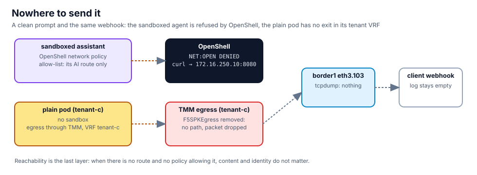

## The sandboxed assistant

Cobalt's sanctioned assistant lives in sandbox `tenant-c-agent`. A clean POST to the webhook, from inside it:

```bash,run
openshell sandbox exec --name tenant-c-agent -- sh -c 'curl -s -m 8 -o /dev/null -w "webhook: HTTP %{http_code}\n" -X POST http://172.16.250.10:8080/report -d "status=ok" || echo "webhook: refused by the sandbox"'
openshell logs tenant-c-agent --since 2m --source sandbox | grep -E 'DENIED' | tail -3
```

No packet left. The policy is an allow-list and the webhook is not on it.

## The plain pod

The agent of chapter 10 runs as an ordinary pod in `tenant-c`. Watch Cobalt's handoff on border1 in **Terminal 2**
while it posts:

```bash,run
docker exec border1 sh -c 'command -v tcpdump >/dev/null || apk add --no-cache tcpdump >/dev/null 2>&1; echo ready'
```

In Terminal 2: `docker exec border1 tcpdump -ni eth3.103 -c 6 'tcp port 8080'`

```bash,run
P=$(kubectl -n tenant-c get pod -l app=billing-reconciler -o jsonpath='{.items[0].metadata.name}' 2>/dev/null); [ -n "$P" ] || P=$(kubectl -n tenant-c get pod --no-headers | awk '/billing-reconciler/{print $1; exit}')
kubectl -n tenant-c exec "$P" -- sh -c 'wget -q -O- -T 5 --post-data "status=ok" http://172.16.250.10:8080/report 2>&1 | head -1 || echo "post failed"'
docker exec client sh -c 'grep -ac "POST /" /tmp/webhook.log | sed "s/^/POSTs at the webhook: /"'
```

The POST arrived, and border1 saw it on VLAN 103 from `10.203.200.x`, Cobalt's SNAT address: the packet took the
tenant's egress exactly as designed. That is the path to close.

## Remove the tenant's egress

Egress for a namespace is a declaration on BNK. Without it, pods of that namespace have no exit through TMM:

```bash,run
kubectl -n f5-bnk get f5spkegress tenant-c-egress -o jsonpath='namespaces: {.spec.pseudoCNIConfig.namespaces}  snat pool: {.spec.egressSnatpool}{"\n"}'
kubectl -n f5-bnk delete f5spkegress tenant-c-egress
sleep 10
kubectl -n tenant-c exec "$P" -- sh -c 'wget -q -O- -T 5 --post-data "status=ok" http://172.16.250.10:8080/report 2>&1 | head -1 || echo "post failed: no path"'
docker exec client sh -c 'grep -ac "POST /" /tmp/webhook.log | sed "s/^/POSTs at the webhook: /"'
```

Nothing on border1 in Terminal 2 either. Cobalt's sanctioned traffic to its own AI route is unaffected, because
that route is reached through TMM's internal leg, not through egress:

```bash,run
K=$(cat /root/.bnk/aigw/tenant-c.key)
kubectl -n tenant-c exec "$P" -- sh -c "wget -q -O- -T 20 --header 'Authorization: Bearer $K' http://172.16.100.22/v1/models 2>&1 | head -c 200"; echo
unset K
```

## Put it back the right way

Cobalt needs egress for legitimate work. The declaration comes back; what changes is who is allowed to run outside a
sandbox in that namespace, which is a review question, not a routing one:

```bash,run
kubectl apply -f $LAB_ROOT/manifests/bnk/30-egress.yaml
kubectl -n tenant-c delete agent billing-reconciler --ignore-not-found
kubectl -n tenant-c delete secret shadow-key --ignore-not-found
```

## What you saw

- OpenShell: the sandboxed agent cannot open a connection the policy does not list, clean prompt or not.
- BNK: a tenant's exit exists because a declaration says so. Delete the declaration and the packet has nowhere to
  go, which border1's capture confirms.
- Content inspection, identity and reachability each caught something the others could not.
