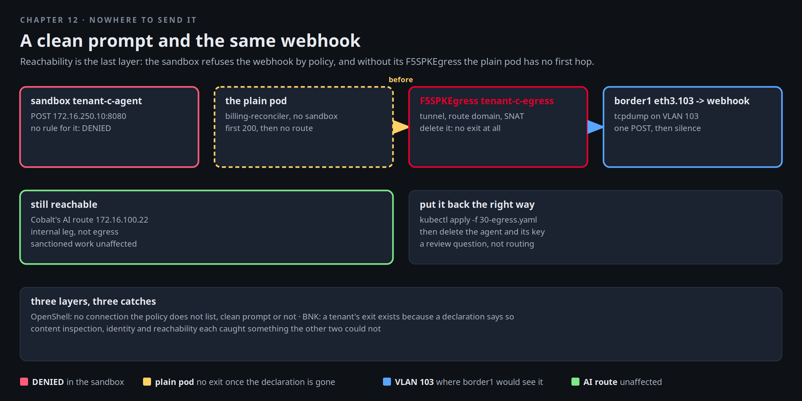

# Nowhere to send it

The scanner reads content, and the developer at Cobalt has read chapter 11 too. Version two of the agent sends a
prompt with nothing in it worth flagging and posts a report that is assembled after the model answers, from the
tool output alone. A clean prompt and the same webhook. Mira's third layer is not about what the request says.
It is about whether the pod has anywhere to send it. The sanctioned assistant runs in a sandbox whose policy does
not list the webhook. The plain pod leaves through Cobalt's egress, and that egress is one declaration on BNK with
one policy on it.



[button label="Open the Lab Topology" variant="outline"](tab-2)

The **Lab Topology** tab opens on **Nowhere to send it**: two attempts that fail in two different places, and the
empty capture on border1.

## The sandboxed assistant

Cobalt's sanctioned assistant lives in sandbox `tenant-c-agent` (started again if it was stopped). A clean POST to the
webhook, from inside it:

```bash,run
for s in tenant-a-agent tenant-b-agent tenant-c-agent; do openshell sandbox list 2>/dev/null | grep -E "^$s\b" | grep -q Ready || openshell sandbox start $s; done; for i in $(seq 1 24); do [ "$(openshell sandbox list 2>/dev/null | grep -c Ready)" -ge 3 ] && break; sleep 5; done
openshell sandbox exec --name tenant-c-agent -- python3 -c '
import urllib.request as u
try: print("webhook: HTTP", u.urlopen(u.Request("http://172.16.250.10:8080/report", data=b"status=ok"), timeout=8).status)
except Exception as x: print("webhook: refused by the sandbox:", str(x)[:60])'
sleep 12; openshell logs tenant-c-agent --since 2m --source sandbox 2>/dev/null | grep -E 'Denied|DENIED' | tail -3 | cut -c1-200
```

No packet left. The policy is an allow-list, the webhook is not on it, and the refusal is in the log with the binary
and the destination. The sandbox hands its log to the gateway every ten seconds, hence the pause. Nothing about the
content was consulted. The webhook log in **Terminal 2** has not moved:

```
docker exec client tail -f /tmp/webhook.log
```

## The plain pod

The agent of chapter 10 runs as an ordinary pod in `tenant-c`. Its image has no shell, so the POST comes from the
other plain pod in Cobalt's namespace, `hello`, which leaves the factory the same way: same namespace, same
declaration, same tunnel. Before you post, put a capture on Cobalt's handoff at border1, on the VLAN 103
sub-interface towards r5. That is the last hop inside the factory, and it sees every packet that leaves Cobalt's VRF.
Use a third terminal if you have one open, or stop the tail in Terminal 2 for a moment:

```bash,run
docker exec border1 sh -c 'command -v tcpdump >/dev/null || apk add --no-cache tcpdump >/dev/null 2>&1; echo ready'
```

In Terminal 2:

```
docker exec border1 tcpdump -ni eth3.103 -c 6 'tcp port 8080'
```

Now the POST, from the plain pod:

```bash,run
P=$(kubectl -n tenant-c get pod -l app=hello -o jsonpath='{.items[0].metadata.name}'); N=$(kubectl -n tenant-c get pod "$P" -o jsonpath='{.spec.nodeName}'); echo "pod $P on node $N"
kubectl -n tenant-c exec "$P" -- sh -c 'wget -q -O- -T 5 --post-data "status=ok" http://172.16.250.10:8080/report 2>&1 | head -1 || echo "post failed"'; echo
docker exec client sh -c 'grep -ac "POST /report" /tmp/webhook.log | sed "s/^/POSTs at the webhook: /"; grep -a "POST /report" /tmp/webhook.log | tail -1'
```

The POST arrived, and Terminal 2 shows it on VLAN 103 from `10.203.200.10`, Cobalt's SNAT address, which is also what
the webhook logged. The packet took the tenant's egress exactly as designed: tunnel to TMM, route domain tenant-c,
SNAT, VLAN 103, border1, r5, client. That is the path to close.

## Where the path begins

Egress for a namespace is one declaration on BNK. Read it: which namespace it steers, which SNAT pool it uses, and
which firewall policy TMM enforces on it. Then look at the node the pod runs on. BNK's CSRC daemonset built a VXLAN
tunnel there to TMM's leg for Cobalt, `int-c`, a VLAN that lives inside Cobalt's VRF, and wrote one policy rule per
steered pod that sends the pod's traffic into it. The pod itself still has Calico's default route and knows nothing:

```bash,run
kubectl -n f5-bnk get f5-spk-egresses tenant-c-egress -o jsonpath='namespaces: {.spec.pseudoCNIConfig.namespaces}  snat pool: {.spec.egressSnatpool}  vrf: {.spec.pseudoCNIConfig.vxlan.vrf}  policy: {.spec.firewallEnforcedPolicy}{"\n"}'
kubectl -n f5-bnk get f5-spk-egresses -o custom-columns='NAME:.metadata.name,NAMESPACES:.spec.pseudoCNIConfig.namespaces,SNAT:.spec.egressSnatpool,POLICY:.spec.firewallEnforcedPolicy'
kubectl -n f5-bnk get f5-big-fw-policies egress-allow-c -o jsonpath='{.spec.rule}{"\n"}'
docker exec "$N" sh -c 'ip -br addr show int-c; ip -br link show type vxlan | grep -v calico; ip rule | grep -vE "lookup (local|main|default)$"'
kubectl -n tenant-c exec "$P" -- ip route
```

Three egress objects, one per tenant, each steering its own namespace into its own route domain, each with its own
policy. The egress object is immutable once TMM holds it. The policy is the part of the exit that changes in place,
and that is where Mira closes it.

## Close the exit

Restart the capture in Terminal 2 (the same tcpdump line), then apply the closed version of Cobalt's egress policy.
Same name, one rule, action reject:

```bash,run
cat $LAB_ROOT/manifests/chapters/12-exit-closed-c.yaml
kubectl apply -f $LAB_ROOT/manifests/chapters/12-exit-closed-c.yaml
sleep 5; kubectl -n f5-bnk get f5-big-fw-policies egress-allow-c -o jsonpath='{.spec.rule[0].action}{"\n"}' | sed 's/^/policy egress-allow-c: /'
kubectl -n tenant-c exec "$P" -- sh -c 'wget -q -O- -T 5 --post-data "status=ok" http://172.16.250.10:8080/report 2>&1 | head -1 || echo "post failed: refused"'; echo
docker exec client sh -c 'grep -ac "POST /report" /tmp/webhook.log | sed "s/^/POSTs at the webhook: /"'
```

The connection was refused at once, the count did not move, and Terminal 2 stays empty: border1 never saw a packet.
The SYN went into the tunnel and reached TMM, TMM looked up the policy on Cobalt's exit and answered with a reset.
Nothing was SNATed, nothing was routed, nothing crossed the handoff. The exit is still declared. What it does is what
its policy says.

Cobalt's sanctioned traffic to its own AI route is unaffected, because that route is reached through TMM's internal
leg on the node, not through egress:

```bash,run
K=$(cat /root/.bnk/aigw/tenant-c.key)
kubectl -n tenant-c exec "$P" -- sh -c "wget -q -O- -T 20 --header 'Authorization: Bearer $K' http://172.16.100.22/v1/models 2>&1 | head -c 200"; echo
unset K
docker exec "$N" ip route get 172.16.100.22 | head -1
```

The node's route for `172.16.100.0/24` points at TMM's internal self IP. The model is reachable. The outside is not.

## Put it back the right way

Cobalt needs egress for legitimate work, so the policy opens again from the same file that declared it. What changes
is who is allowed to run outside a sandbox in that namespace. That is a review question. Remove the agent and its
key:

```bash,run
kubectl apply -f $LAB_ROOT/manifests/bnk/30-egress.yaml
sleep 5; kubectl -n f5-bnk get f5-big-fw-policies egress-allow-c -o jsonpath='{.spec.rule[0].action}{"\n"}' | sed 's/^/policy egress-allow-c: /'
kubectl -n tenant-c delete agent billing-reconciler --ignore-not-found
kubectl -n tenant-c delete secret shadow-key --ignore-not-found
kubectl -n tenant-c exec "$P" -- sh -c 'wget -q -O- -T 5 --post-data "status=restored" http://172.16.250.10:8080/report 2>&1 | head -1 || echo "post failed"'; echo
docker exec client sh -c 'grep -a "POST /report" /tmp/webhook.log | tail -1'
```

The count moved again, from Cobalt's SNAT address: the exit is open for the pods that remain.

## Three layers, three catches

- OpenShell: the sandboxed agent cannot open a connection the policy does not list, clean prompt or not.
- BNK: a tenant's exit is a declaration with a policy on it. Close the policy and TMM refuses the connection before
  the fabric sees it, which border1's capture confirms.
- Content inspection, identity and reachability each caught something the other two could not. Chapter 13 writes
  that up from the records each one kept.

## Checkpoint

The check expects a denied connection to `172.16.250.10` in the sandbox's log, Cobalt's egress policy
`egress-allow-c` back at accept, and the agent `billing-reconciler` gone.
