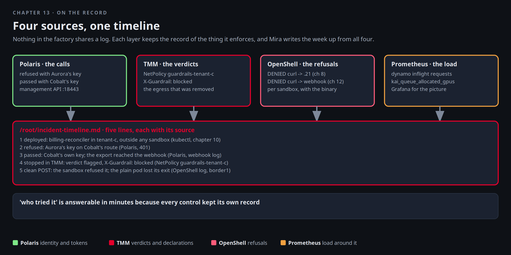

# On the record

Cobalt's security lead wants the incident written up by Wednesday: what ran, what it reached, what stopped it, and
when. Nothing in the factory shares a log. Mira does not need it to. Each layer kept the record of the thing it
enforces: Polaris has the calls and the keys, TMM has the verdict and the declarations, OpenShell has the refusals,
Prometheus has the load around all of it. This chapter reads the four and writes the timeline.



[button label="Open the Lab Topology" variant="outline"](tab-2)

The **Lab Topology** tab opens on **The agent nobody approved**; every hop in that flow has a record somewhere
below.

## Polaris: the calls

Open the **Polaris** tab and look at tenant `tenant-c`. Three kinds of call are there from chapters 10 and 11: the
refused ones with Aurora's key, the ones that passed with Cobalt's key, and the ones that never reached a model
because TMM answered them.

[button label="Open Polaris" variant="success"](tab-3)

The same facts from the management API, which the console uses. Log in with the admin account, then list the
tenant's keys and models:

```bash,run
API=http://127.0.0.1:18443; NS=f5-bnk
TOK=$(python3 -c 'import json,sys; print(json.dumps({"username":sys.argv[1],"password":sys.argv[2]}))' "$(kubectl -n $NS get secret f5-aigateway-admin -o jsonpath='{.data.username}' | base64 -d)" "$(kubectl -n $NS get secret f5-aigateway-admin -o jsonpath='{.data.password}' | base64 -d)" | curl -sS $API/api/v1/auth/login -H 'Content-Type: application/json' --data-binary @- | python3 -c 'import json,sys; print(json.load(sys.stdin).get("access_token",""))')
curl -sS $API/api/v1/tenants/tenant-c/virtual-keys -H "Authorization: Bearer $TOK" | python3 -c 'import json,sys; [print(" key:", k.get("name"), "principal:", k.get("principalId"), "scope:", k.get("modelScope")) for k in (json.load(sys.stdin).get("items") or [])]'
curl -sS $API/api/v1/tenants/tenant-c/models -H "Authorization: Bearer $TOK" | python3 -c 'import json,sys; [print(" model:", m.get("name"), m.get("state")) for m in (json.load(sys.stdin).get("items") or [])]'
```

One key, one model, both Cobalt's. Every call the shadow agent made with Cobalt's key is attributed to that key,
which is the key the sanctioned assistant uses. That is the first finding for the write-up: the record is per key,
and Cobalt gave two workloads one key. The request history itself, with timestamps, is the console's job:

```bash,run
curl -sS "$API/api/v1/tenants/tenant-c/requests?limit=10" -H "Authorization: Bearer $TOK" 2>/dev/null | python3 -c 'import json,sys
try:
    d=json.load(sys.stdin); items=d.get("items") or d.get("data") or []
    for r in items[:10]: print(" ", r.get("createdAt") or r.get("timestamp"), r.get("status") or r.get("statusCode"), r.get("model"), r.get("principalId") or r.get("virtualKeyId"))
    if not items: print("  (no request list on this endpoint; use the Polaris tab for request history)")
except Exception as e: print("  (request history is in the Polaris tab)")'
unset TOK
```

## TMM: the verdict

The guardrail answered the flagged request with a 200 and `X-Guardrail: blocked`, so the client saw a model reply
that was not one. The policy that did it, the iRule's own view of what it refuses, and the egress declaration that
was removed and restored:

```bash,run
kubectl -n f5-bnk get netpolicy guardrails-tenant-c -o jsonpath='{.spec}' | python3 -m json.tool
kubectl -n f5-bnk get f5bigcneirule guardrails -o jsonpath='{.spec.iRule}' | grep -oE 'HTTP::respond [0-9]+|X-Guardrail[^"]*' | sort | uniq -c
kubectl -n f5-bnk get f5spkegress tenant-c-egress -o jsonpath='{.metadata.creationTimestamp}{"\n"}'
```

That creation timestamp is from this session, not from track start: the egress object was deleted and re-created in
chapter 12. Kubernetes keeps the fact, and the audit log would keep who did it. Keep **Terminal 2** on the BNK
controller's recent log while you read; it names every object it programmed today:

```
kubectl -n f5-bnk logs deploy/f5-cne-controller --since=3h | grep -iE 'netpolicy|egress|irule' | tail -20
```

## OpenShell: the refusals

Every connection a sandbox was not allowed to open, with the binary that tried and the destination:

```bash,run
for s in tenant-a-agent tenant-c-agent; do echo "== $s"; openshell logs $s --since 6h --source sandbox 2>/dev/null | grep -E 'DENIED' | sed 's/^/  /' | tail -4; done
```

Two sandboxes, two kinds of refusal: Aurora's reaching for Borealis's route in chapter 8, Cobalt's reaching for the
webhook in chapter 12. Neither packet existed on the network, so neither shows in any capture, which is why the
sandbox's own log is the only record of them.

## Prometheus: the load around it

The workers' running requests during the week and the GPU queues. In the **Prometheus** tab, graph the two
expressions below over the last few hours; the burst from chapter 4 and the jobs from chapter 3 are visible.

[button label="Open Prometheus" variant="success"](tab-5)

```
vllm:num_requests_running
sum by (queue) (kai_queue_allocated_gpus)
```

From the terminal, the same numbers now, and the Grafana login for the picture:

```bash,run
curl -s 'http://127.0.0.1:30909/api/v1/query?query=vllm:num_requests_running' | python3 -c 'import json,sys; [print(" ", r["metric"].get("pod","?"), r["value"][1]) for r in json.load(sys.stdin)["data"]["result"]]'
curl -s 'http://127.0.0.1:30909/api/v1/query?query=sum(kai_queue_allocated_gpus)by(queue)' | python3 -c 'import json,sys; [print(" ", r["metric"].get("queue","?"), r["value"][1]) for r in json.load(sys.stdin)["data"]["result"]] or print("  (no allocated GPUs right now)")'
cat /root/.bnk/grafana-admin; echo
```

[button label="Open Grafana" variant="success"](tab-4)

## The webhook and the fabric

Two more records live outside the cluster: the webhook's own log on the client, and the capture you ran on border1.
The log has every POST with a timestamp; the capture had one burst on VLAN 103 and then nothing:

```bash,run
docker exec client sh -c 'grep -ac "POST /" /tmp/webhook.log | sed "s/^/POSTs received: /"; grep -aoE "^> [0-9/ :.]+" /tmp/webhook.log | tail -3'
```

## Write the timeline

Five lines. Each one has a source above. Edit the dates if you want them exact; the check only needs the facts:

```bash,run
cat > /root/incident-timeline.md <<'EOF'
# Northlight Compute, week seven: the agent nobody approved

1. Deployed: agent `billing-reconciler` in tenant-c, outside any sandbox.          (kubectl, chapter 10)
2. First run refused: Aurora's key on Cobalt's route.                               (Polaris, tenant-c, 401)
3. Second run passed: Cobalt's own key; the export reached the webhook.             (Polaris + webhook log)
4. Third run stopped in TMM: guardrail verdict `flagged`, X-Guardrail: blocked.     (NetPolicy guardrails-tenant-c)
5. Clean POST: sandbox refused it; plain pod lost its exit when the egress declaration was removed. (OpenShell log, border1)

Finding: one key for two workloads. Every call above is attributed to the sanctioned assistant's key.
Action: a key per workload, and no plain pods in tenant namespaces without review.
EOF
cat /root/incident-timeline.md
```

## What Mira sends on Wednesday

One timeline from four systems that never talked to each other, each keeping the record of the thing it enforces.
That is what makes "who tried it" answerable in minutes, and it is the argument for the last, optional chapter:
what the picker can and cannot know about where things run.

## Checkpoint

The check expects `/root/incident-timeline.md` to exist and to mention the guardrail verdict.
