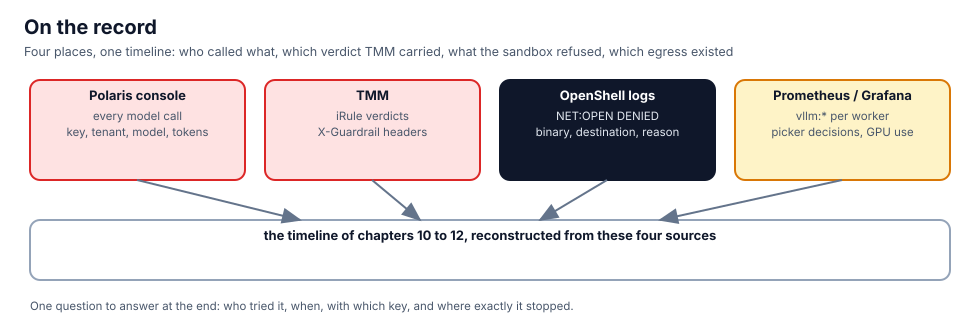

## Polaris: the calls

Open the **Polaris** tab and look at tenant `tenant-c`. Three kinds of call are there from chapters 10 and 11: the
refused ones with Aurora's key, the ones that passed with Cobalt's key, and the ones that never reached a model
because TMM answered them. The same facts from the management API, which the Polaris console uses:

```bash,run
API=http://127.0.0.1:18443; NS=f5-bnk
TOK=$(python3 -c 'import json,sys; print(json.dumps({"username":sys.argv[1],"password":sys.argv[2]}))' "$(kubectl -n $NS get secret f5-aigateway-admin -o jsonpath='{.data.username}' | base64 -d)" "$(kubectl -n $NS get secret f5-aigateway-admin -o jsonpath='{.data.password}' | base64 -d)" | curl -sS $API/api/v1/auth/login -H 'Content-Type: application/json' --data-binary @- | python3 -c 'import json,sys; print(json.load(sys.stdin).get("access_token",""))')
curl -sS $API/api/v1/tenants/tenant-c/virtual-keys -H "Authorization: Bearer $TOK" | python3 -c 'import json,sys; [print(" key:", k.get("name"), "principal:", k.get("principalId"), "scope:", k.get("modelScope")) for k in (json.load(sys.stdin).get("items") or [])]'
curl -sS $API/api/v1/tenants/tenant-c/models -H "Authorization: Bearer $TOK" | python3 -c 'import json,sys; [print(" model:", m.get("name"), m.get("state")) for m in (json.load(sys.stdin).get("items") or [])]'
unset TOK
```

## TMM: the verdict

The guardrail answered the flagged request with a 200 and `X-Guardrail: blocked`, so the client saw a model reply
that was not one. The policy that did it, and the iRule's own view of what it refuses:

```bash,run
kubectl -n f5-bnk get netpolicy guardrails-tenant-c -o jsonpath='{.spec}' | python3 -m json.tool
kubectl -n f5-bnk get f5bigcneirule guardrails -o jsonpath='{.spec.iRule}' | grep -oE 'HTTP::respond [0-9]+' | sort | uniq -c
```

## OpenShell: the refusals

Every connection a sandbox was not allowed to open, with the binary that tried and the destination:

```bash,run
for s in tenant-a-agent tenant-c-agent; do echo "== $s"; openshell logs $s --since 6h --source sandbox 2>/dev/null | grep -E 'DENIED' | sed 's/^/  /' | tail -4; done
```

## Prometheus: the load around it

The workers' running requests during the week, and the GPU queues. In the **Prometheus** tab, graph:

```
vllm:num_requests_running
sum by (queue) (kai_queue_allocated_gpus)
```

From the terminal, the same numbers now:

```bash,run
curl -s 'http://127.0.0.1:30909/api/v1/query?query=vllm:num_requests_running' | python3 -c 'import json,sys; [print(" ", r["metric"].get("pod","?"), r["value"][1]) for r in json.load(sys.stdin)["data"]["result"]]'
```

## Write the timeline

Fill in the five lines. Each one has a source above.

```bash,run
cat > /root/incident-timeline.md <<'EOF'
# Northlight Compute, week seven: the agent nobody approved

1. Deployed: agent `billing-reconciler` in tenant-c, outside any sandbox.          (kubectl, chapter 10)
2. First run refused: Aurora's key on Cobalt's route.                               (Polaris, tenant-c, 401)
3. Second run passed: Cobalt's own key; the export reached the webhook.             (Polaris + webhook log)
4. Third run stopped in TMM: guardrail verdict `flagged`, X-Guardrail: blocked.     (NetPolicy guardrails-tenant-c)
5. Clean POST: sandbox refused it; plain pod lost its exit when the egress declaration was removed. (OpenShell log, border1)
EOF
cat /root/incident-timeline.md
```

## What you saw

One timeline from four systems that never talked to each other, each keeping the record of the thing it enforces.
That is what makes "who tried it" answerable in minutes.
