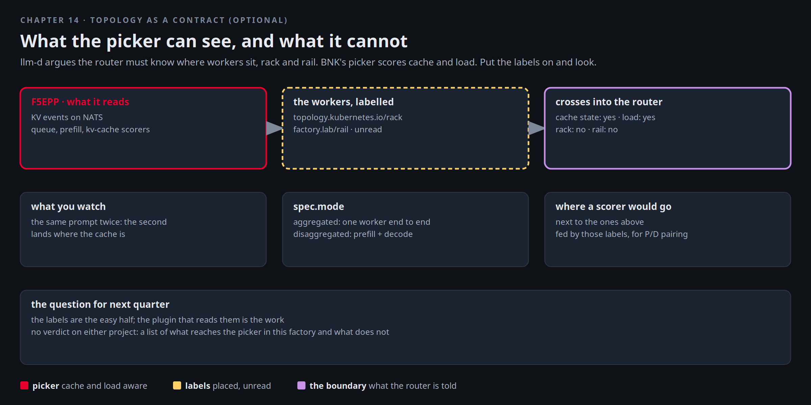

# Topology as a contract

Planning for next quarter. Northlight's GPU team has read llm-d's argument that topology is an end-to-end contract:
the router must know where workers sit, which rack and which rail, to pair prefill and decode well on a real
fabric. They ask Mira whether the factory's picker does that. The short answer is that it scores the things it can
see on the workers themselves, prefix cache, prefill load, queue depth and KV usage, and it does not score where a
worker sits, because nothing tells it. This chapter puts the labels on, reads what the picker is configured to
read, and leaves the design question on the table where it belongs. It is optional and short.



[button label="Open the Lab Topology" variant="outline"](tab-2)

The **Lab Topology** tab opens on **The pool VIP and the picker**, the flow from chapter 4.

## What the picker reads

The picker's plugins, as configured on the `F5EPP`: a wire into Dynamo's KV events, a metrics extractor, a
saturation detector, and the scorers:

```bash,run
kubectl -n aigw-models get f5-epps model-pool-epp -o jsonpath='{.spec.eppConfig.config.plugins[*].type}{"\n"}' | tr ' ' '\n' | sed 's/^/  plugin: /'
kubectl -n aigw-models get f5-epps model-pool-epp -o jsonpath='{.spec.engine} {.spec.natsURL} mode={.spec.mode}{"\n"}'
```

Nothing in that list is a topology scorer. The picker sees two workers and their state, not their place. The
signals that do cross the boundary into the router, and how:

```bash,run
kubectl -n aigw-models get cm model-pool-epp-config -o jsonpath='{.data.pool\.yaml}' | sed -n '/plugins:/,/schedulingProfiles:/p' | head -30
P=$(kubectl -n aigw-models get pods -o name | grep epp | head -1)
kubectl -n aigw-models logs $P --since=1h | grep -iE 'nats|kv.?event|metric' | tail -4
```

## Put the place on the workers

llm-d's contract is carried by labels: which rack, which rail (the NIC path to the switch). Label the mocker's
decode pods as if they sat in two racks on two rails:

```bash,run
i=0; for p in $(kubectl -n aigw-models get pods -l nvidia.com/dynamo-component-type=decode -o name 2>/dev/null || kubectl -n aigw-models get pods -o name | grep decode); do
  kubectl -n aigw-models label $p topology.kubernetes.io/rack=rack-$((i%2+1)) factory.lab/rail=rail-$((i%2+1)) --overwrite >/dev/null; i=$((i+1)); done
kubectl -n aigw-models get pods -L topology.kubernetes.io/rack,factory.lab/rail --no-headers | grep decode | awk '{print $1, $(NF-1), $NF}'
```

The labels exist. Nothing reads them. The `InferencePool`'s selector still matches the pods, so the picker's view is
unchanged:

```bash,run
kubectl -n aigw-models get inferencepool model-pool -o jsonpath='{.spec.selector}{"\n"}'
kubectl -n aigw-models get inferencepool model-pool -o jsonpath='{.status}' | python3 -c 'import json,sys; s=json.load(sys.stdin); print(json.dumps(s, indent=1)[:600])'
```

## Send the same request twice

Two identical prompts: the second lands where the cache is. That is the picker honouring a contract it can see,
the prefix cache, with nothing about rack or rail involved. Keep **Terminal 2** on the picker's log:

```
P=$(kubectl -n aigw-models get pods -o name | grep epp | head -1); kubectl -n aigw-models logs -f $P | grep --line-buffered -iE 'EPP (received|sent)|dynamo|kv-events|kv_metrics|recovered|pick|select'
```

```bash,run
K=$(cat /root/.bnk/aigw/lab.key)
for n in 1 2; do docker exec client curl -s -m 120 http://172.16.100.13/v1/chat/completions -H "Authorization: Bearer $K" -H 'Content-Type: application/json' \
  -d '{"model":"qwen3-0.6b-dynamo","messages":[{"role":"user","content":"Explain in two sentences why a rail-aligned fabric matters for prefill and decode."}],"max_tokens":40}' >/dev/null; done
unset K
kubectl -n aigw-models logs $P --since=6h | grep -iE 'dynamo|kv-events|kv_metrics|recovered|pick|select' | tail -6
```

This time the request went through the lab tenant's Polaris route on `172.16.100.13`, whose model `qwen3-0.6b-dynamo`
is the Dynamo pool behind the pool VIP. Same picker, one more layer in front of it, same choice. Terminal 2 shows the
two requests arrive and leave. What the log holds at its default level is the picker's wire to the workers: the first
KV events and KV metrics over NATS from the Dynamo backend, logged once when the first request of the session reached
them in chapter 4, and the metrics poller recovering each worker, which is why the read covers the whole session. The
choice itself is made from those, and the decision lines sit at debug level.

## Disaggregated, on paper

The `F5EPP` can split the pool into prefill and decode workers by label and pick one of each. Read the field and the
label it keys on. That is the closest thing in this factory to a topology-aware decision, and it is still about role,
not place:

```bash,run
kubectl explain f5-epps.spec.mode | sed -n '1,20p'
kubectl -n aigw-models get pods --no-headers -o custom-columns='POD:.metadata.name,TYPE:.metadata.labels.nvidia\.com/dynamo-component-type' | grep -v '<none>'
```

## The question for next quarter

- Which signals cross the boundary into the router today: cache state and load, over NATS and metrics.
- Which do not: rack, rail, link utilisation. They exist on the pods now as labels and nothing reads them.
- Where it would go: a scorer plugin next to the ones above, fed by those labels, for prefill and decode pairing on
  a real fabric. The labels are the easy half. The plugin that reads them is the work.

Nothing here is a verdict on either project. It is the list of what reaches the picker in this factory and what
does not, which is what the GPU team asked for.

## Checkpoint

This chapter has no check beyond the labels being present on the decode pods.
