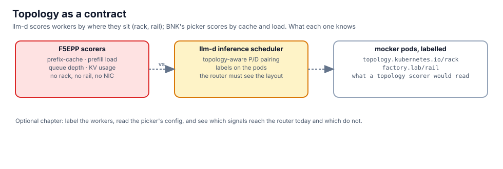

## What the picker reads

The picker's plugins, as configured on the `F5EPP`: a wire into Dynamo's KV events, a metrics extractor, a
saturation detector, and the scorers:

```bash,run
kubectl -n aigw-models get f5epp model-pool-epp -o jsonpath='{.spec.eppConfig.config.plugins[*].type}{"\n"}' | tr ' ' '\n' | sed 's/^/  plugin: /'
kubectl -n aigw-models get f5epp model-pool-epp -o jsonpath='{.spec.engine} {.spec.natsURL}{"\n"}'
```

Nothing in that list is a topology scorer. The picker sees two workers and their state, not their place.

## Put the place on the workers

llm-d's contract is carried by labels: which rack, which rail (the NIC path to the switch). Label the mocker pods
as if they sat in two racks on two rails:

```bash,run
i=0; for p in $(kubectl -n aigw-models get pods -l nvidia.com/dynamo-component-type=decode -o name 2>/dev/null || kubectl -n aigw-models get pods -o name | grep decode); do
  kubectl -n aigw-models label $p topology.kubernetes.io/rack=rack-$((i%2+1)) factory.lab/rail=rail-$((i%2+1)) --overwrite >/dev/null; i=$((i+1)); done
kubectl -n aigw-models get pods -L topology.kubernetes.io/rack,factory.lab/rail --no-headers | grep decode | awk '{print $1, $(NF-1), $NF}'
```

## Send the same request twice

Two identical prompts: the second lands where the cache is. That is the picker honouring a contract it can see
(the prefix cache), with nothing about rack or rail involved:

```bash,run
P=$(kubectl -n aigw-models get pod -l app=model-pool-epp -o jsonpath='{.items[0].metadata.name}')
K=$(cat /root/.bnk/aigw/lab.key)
for n in 1 2; do docker exec client curl -s -m 120 http://172.16.100.13/v1/chat/completions -H "Authorization: Bearer $K" -H 'Content-Type: application/json' \
  -d '{"model":"qwen3-0.6b-dynamo","messages":[{"role":"user","content":"Explain in two sentences why a rail-aligned fabric matters for prefill and decode."}],"max_tokens":40}' >/dev/null; done
unset K
kubectl -n aigw-models logs $P --since=2m | grep -iE 'pick|select|endpoint|score' | tail -6
```

## The question for next quarter

- Which signals cross the boundary into the router today: cache state and load, over NATS and metrics.
- Which do not: rack, rail, link utilisation. They exist on the pods now as labels and nothing reads them.
- Where it would go: a scorer plugin next to the ones above, fed by those labels, for P/D pairing on a real fabric.

Nothing here is a verdict on either project. It is the list of what reaches the picker in this factory and what
does not.
